[English](README.md) | **Français**

# AgriTrace

[](https://github.com/MourabitElBachir/traceability-graph-agents/actions/workflows/ci.yml)


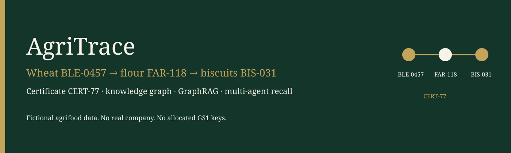

Projet portfolio d'**El Bachir Mourabit** (Senior Data Engineer / architecte IA).

Il montre une façon « prête pour la production » de tracer un lot alimentaire et de vérifier ses certificats : une petite ontologie, un extrait SQL, un graphe de propriétés, une recherche hybride et un workflow multi-agents qui s'arrête pour qu'une personne valide avant toute recommandation de rappel.

**Toutes les données sont fictives.** Fermes, moulins, certificats, auditeurs et noms de référentiels ont été inventés pour ce dépôt. Aucun client n'est cité. Les identifiants comme `DEMO-GLN-*` ne sont pas des clés GS1 attribuées.

Le même contenu est découpé dans [`docs/`](docs/), [`docs/fr/`](docs/fr/) et [`docs/confluence/`](docs/confluence/) pour être publié ailleurs. Ce README est la traduction française complète du [README anglais](README.md), qui reste la version de référence.

## Sommaire

1. [Contexte métier](#1-contexte-métier)
2. [Les concepts en langage simple](#2-les-concepts-en-langage-simple)
3. [L'exemple fil rouge](#3-lexemple-fil-rouge)
4. [Parcours des données](#4-parcours-des-données)
5. [Architecture](#5-architecture)
6. [Ontologie et schéma du graphe](#6-ontologie-et-schéma-du-graphe)
7. [Agents](#7-agents)
8. [Recherche (retrieval)](#8-recherche-retrieval)
9. [Outils](#9-outils)
10. [Sécurité et gouvernance](#10-sécurité-et-gouvernance)
11. [Choix de conception et limites](#11-choix-de-conception-et-limites)
12. [Évaluation](#12-évaluation)
13. [Observabilité](#13-observabilité)
14. [Intégration continue](#14-intégration-continue)
15. [Démarrage rapide](#15-démarrage-rapide)
16. [Exemples de questions et de réponses](#16-exemples-de-questions-et-de-réponses)
17. [Feuille de route](#17-feuille-de-route)

---

## 1. Contexte métier

Un responsable qualité, un auditeur ou un distributeur a besoin de deux réponses sur un lot :

1. **Tracer.** D'où vient ce lot, et où est-il allé ?
2. **Certifier.** Quels certificats couvrent cette chaîne, et sont-ils encore valides ?

Lors d'un rappel, les mêmes questions se posent vers l'aval : quelle farine et quels biscuits ont été fabriqués avec ce blé, quel magasin les a reçus, et une personne a-t-elle réellement validé la recommandation ?

La chaîne fil rouge de ce dépôt est volontairement courte :

```text
blé BLE-0457  →  farine FAR-118  →  biscuits BIS-031
couverts par le certificat CERT-77 (Organic Horizon, fictif, valide jusqu'au 2027-12-31)
```

Une seconde ligne, séparée, existe pour que l'agent de conformité ait de vraies anomalies à signaler : le certificat périmé `CERT-78`, la farine mélangée `FAR-221` et le lot d'huile `OIL-009` sans lot source. Ces lots ne font pas partie de la généalogie des biscuits.

Les acteurs de l'histoire, tous fictifs :

| Acteur | Rôle | Ce qu'il manipule |
| --- | --- | --- |
| Ferme des Collines | ferme | met en circulation le blé `BLE-0457` |
| Moulin du Val | moulin | le transforme en farine `FAR-118` |
| Fournil Lumière | usine | cuit les biscuits `BIS-031` |
| DistriNord Logistique | distributeur | transporte `BIS-031` |
| Épicerie Rive | détaillant | reçoit `BIS-031` |
| Organisme Horizon | certificateur | délivre `CERT-77` |
| Atelier Audit Nord | auditeur | inspecte la biscuiterie et le moulin |

---

## 2. Les concepts en langage simple

<details>
<summary>Ontologie : un vocabulaire, pas un produit</summary>

Une ontologie est un vocabulaire partagé : les types de choses dont on parle, leurs relations et quelques règles. Ce n'est ni une base de données ni un éditeur de logiciel.

Dans ce projet, le vocabulaire dit qu'un **Lot** est produit sur un **Site**, qu'une **étape de transformation** consomme des lots et en produit, qu'une **Expédition** déplace des lots et qu'un **Certificat** couvre des lots pendant une période donnée.

**OWL** est un langage pour écrire ce vocabulaire. **RDF** est le modèle de données sous-jacent (sujet, prédicat, objet). **Turtle** est une syntaxe texte pour RDF. **Protégé** est un éditeur de bureau utilisé pour dessiner de l'OWL. Ce dépôt stocke le vocabulaire en Turtle et le lit avec rdflib. Protégé n'est pas nécessaire pour lancer la démo.

Le fichier est [`ontology/traceability.ttl`](ontology/traceability.ttl), version `0.1.0`.

</details>

<details>
<summary>Ontologie, graphe de connaissances, graphe de propriétés</summary>

- L'**ontologie** est le vocabulaire (classes et relations).
- Un **graphe de connaissances** est ce vocabulaire rempli de faits : ce lot de blé, ce moulin, ce certificat.
- Un **graphe de propriétés** (Neo4j) stocke ces faits sous forme de nœuds et de relations porteuses de propriétés. Il est plus simple à parcourir pour « qu'y a-t-il en aval de ce lot ? » qu'une jointure de tables sur des événements.

Le fichier Turtle est le vocabulaire. Les lignes synthétiques de l'ERP sont les faits. Neo4j (ou le graphe en mémoire des tests) en est la projection en graphe de propriétés.

</details>

<details>
<summary>GS1 EPCIS, en bref</summary>

EPCIS est la façon GS1 d'enregistrer des événements de visibilité. Chaque événement répond à :

- **quoi** a été déplacé ou transformé (le lot),
- **quand** (`eventTime`),
- **où** (lieu métier / point de lecture),
- **pourquoi** (`bizStep`, par exemple mise en circulation ou transformation).

Cette ontologie est **inspirée** de ces quatre questions. Ce n'est pas une implémentation d'EPCIS et elle n'utilise pas de vrais identifiants GS1. Les certificats et les audits sont des nœuds explicites, car EPCIS ne les modélise pas comme des événements à part entière.

</details>

<details>
<summary>GraphRAG ou RAG classique</summary>

Le RAG classique vectorise des documents, retrouve des passages similaires et demande à un modèle de répondre à partir de ces passages. Il est faible quand la question est structurelle : « qu'y a-t-il en aval de ce lot ? »

Ici, le GraphRAG fait les deux :

- **Parcours de graphe** pour la généalogie et les certificats (exact).
- **Similarité vectorielle** pour le texte des audits et des certificats, chaque passage étant relié aux lots qu'il mentionne.

La réponse est assemblée à partir de ces résultats d'outils. Le modèle de langage ne fait que les formuler, et seule la formulation en mode non-mock peut quitter la machine.

</details>

<details>
<summary>LangChain et LangGraph</summary>

**LangChain** (paquet `langchain-core`) fournit les modèles de prompts (`ChatPromptTemplate`) pour le text-to-Cypher et pour le court récit. Voir [`src/agritrace/llm/provider.py`](src/agritrace/llm/provider.py) et [`src/agritrace/retrieval/text_to_cypher.py`](src/agritrace/retrieval/text_to_cypher.py).

**LangGraph** exécute le workflow : un superviseur oriente la question, des nœuds spécialisés appellent les outils, un checkpointer mémorise le fil de conversation et une interruption arrête le graphe avant l'émission d'un rappel. Voir [`src/agritrace/agents/graph.py`](src/agritrace/agents/graph.py).

LangChain ne choisit pas l'aiguillage. Le routeur mock repose sur des mots-clés déterministes, pour que la CI ne dépende pas d'un modèle.

</details>

<details>
<summary>MCP et A2A</summary>

**MCP** (Model Context Protocol) expose des outils qu'un autre assistant peut appeler : `trace_lot`, `check_certificates`, `search_documents`. Le serveur est [`src/agritrace/mcp/server.py`](src/agritrace/mcp/server.py) (`python -m agritrace.mcp.server` en stdio).

**A2A** (agent-to-agent) est une autre idée : un agent en découvre un autre grâce à une carte et lui envoie une tâche. Ce dépôt sert une carte **minimale et clairement étiquetée** sur `GET /.well-known/agent-card.json` et accepte `POST /a2a/tasks`. C'est un sous-ensemble pédagogique (`protocol: a2a-minimal-0.1`), pas une pile A2A complète.

</details>

---

## 3. L'exemple fil rouge

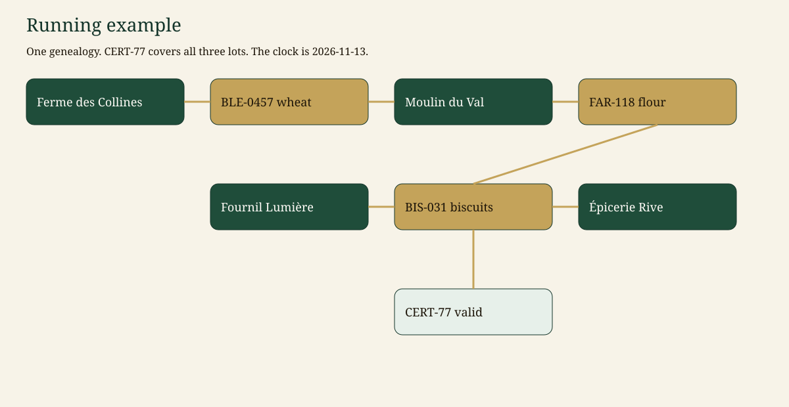

| Étape | Id | Ce qui se passe |
| --- | --- | --- |
| Mise en circulation | `BLE-0457` | La Ferme des Collines récolte 12 000 kg de blé le 2026-06-12 |
| Transformation | `P-MILL-118` | Le Moulin du Val transforme ce blé en farine `FAR-118` (9 400 kg) le 2026-07-03 |
| Transformation | `P-BAKE-031` | Le Fournil Lumière cuit la farine en biscuits `BIS-031` (7 100 kg) le 2026-07-22 |
| Expéditions | `SHIP-BIS-1`, `SHIP-BIS-2` | Biscuiterie → DistriNord → Épicerie Rive |
| Certificat | `CERT-77` | Organic Horizon, **valide** du 2025-04-01 au 2027-12-31, couvre les trois lots |

L'horloge de la démo est fixée au **2026-11-13** (`AGRITRACE_AS_OF`). Elle ne suit pas l'heure réelle, donc `CERT-77` reste valide et `CERT-78` reste périmé dans la CI.

Les mêmes identifiants se retrouvent dans le jeu de données ([`src/agritrace/data/generator.py`](src/agritrace/data/generator.py)), le jeu d'évaluation ([`src/agritrace/eval/dataset.json`](src/agritrace/eval/dataset.json)), les tests et les réponses ci-dessous.

<details>
<summary>Les autres lots, et pourquoi ils ne sont pas l'exemple</summary>

| Id | Pourquoi il existe |
| --- | --- |
| `BLE-0881` | Blé de la Ferme Brume. Couvert seulement par `CERT-78`, périmé (valid_to 2026-03-01). |
| `BLE-0902` | Blé de la Ferme des Saules, avec `CERT-79` valide. |
| `FAR-221` | Farine issue du mélange de `BLE-0881` et `BLE-0902`. Allégation bio, pas de certificat valide, intrants mélangés. |
| `OIL-009` | Huile d'olive dont la transformation déclare des olives et **aucun lot source** (`broken_chain`). |

`BLE-0457` n'est pas un intrant de `FAR-221`. Rappeler le blé ne rappelle pas la farine mélangée, et la farine mélangée n'apparaît pas dans la trace des biscuits.

</details>

---

## 4. Parcours des données

Cette section suit un seul fil, `BLE-0457 → FAR-118 → BIS-031` couvert par `CERT-77`, à travers chaque format que prennent les données. Chaque extrait est copié depuis les fichiers du dépôt ou depuis la sortie du code en mode mock (`LLM_MODE=mock`, `GRAPH_BACKEND=memory`, `AGRITRACE_AS_OF=2026-11-13`). Les longues listes sont raccourcies avec `...`. Les données et les sorties du programme restent en anglais, comme dans le code.


### 4.1 Lignes source de l'ERP (SQL)

L'extrait ERP est le système de référence. [`src/agritrace/data/schema.sql`](src/agritrace/data/schema.sql) définit des tables simples. Une transformation est une ligne de `process_steps` plus ses lots en entrée et en sortie : la chaîne est stockée sous forme de faits, pas de chemin. Les listes comme `claimed_schemes` et `covers_lot_ids` sont du JSON stocké en `TEXT`, que Postgres accepte aussi.

```sql
CREATE TABLE lots (
    id TEXT PRIMARY KEY,
    lot_code TEXT NOT NULL,
    product_id TEXT NOT NULL REFERENCES products(id),
    quantity REAL NOT NULL,
    unit TEXT NOT NULL,
    produced_on TEXT NOT NULL,
    site_id TEXT NOT NULL REFERENCES sites(id),
    claimed_schemes TEXT NOT NULL
);

CREATE TABLE process_inputs (
    step_id TEXT NOT NULL REFERENCES process_steps(id),
    lot_id TEXT NOT NULL REFERENCES lots(id),
    quantity REAL NOT NULL,
    unit TEXT NOT NULL,
    PRIMARY KEY (step_id, lot_id)
);
```

Les lignes du fil, relues dans SQLite après [`write_dataset`](src/agritrace/data/erp.py) :

`lots`

| id | product_id | quantity | unit | produced_on | site_id | claimed_schemes |
| --- | --- | --- | --- | --- | --- | --- |
| BLE-0457 | PRD-WHEAT | 12000.0 | kg | 2026-06-12 | SITE-COLLINES | `["Organic Horizon"]` |
| FAR-118 | PRD-FLOUR | 9400.0 | kg | 2026-07-03 | SITE-VAL | `["Organic Horizon"]` |
| BIS-031 | PRD-BISCUIT | 7100.0 | kg | 2026-07-22 | SITE-LUMIERE | `["Organic Horizon"]` |

`process_steps`, `process_inputs`, `process_outputs`

| id de l'étape | biz_step | event_time | site_id | lot en entrée (kg) | lot en sortie (kg) |
| --- | --- | --- | --- | --- | --- |
| P-MILL-118 | transformation | 2026-07-03T09:30:00+00:00 | SITE-VAL | BLE-0457 (12000.0) | FAR-118 (9400.0) |
| P-BAKE-031 | transformation | 2026-07-22T06:15:00+00:00 | SITE-LUMIERE | FAR-118 (9400.0) | BIS-031 (7100.0) |

`shipments` et `shipment_lines`

| id | shipped_on | from_site_id | to_site_id | sscc | lot |
| --- | --- | --- | --- | --- | --- |
| SHIP-BIS-1 | 2026-07-23 | SITE-LUMIERE | SITE-DISTNORD | DEMO-SSCC-BIS-1 | BIS-031 |
| SHIP-BIS-2 | 2026-07-24 | SITE-DISTNORD | SITE-RIVE | DEMO-SSCC-BIS-2 | BIS-031 |

`certificates`

```json
{"id": "CERT-77", "scheme": "Organic Horizon", "status": "valid",
 "valid_from": "2025-04-01", "valid_to": "2027-12-31",
 "issuer_actor_id": "ACT-HORIZON", "holder_actor_id": "ACT-LUMIERE",
 "covers_lot_ids": "[\"BLE-0457\", \"FAR-118\", \"BIS-031\"]",
 "covers_site_ids": "[\"SITE-COLLINES\", \"SITE-VAL\", \"SITE-LUMIERE\"]",
 "covers_actor_ids": "[\"ACT-COLLINES\", \"ACT-VAL\", \"ACT-LUMIERE\"]"}
```

### 4.2 Ingestion et contrôles qualité

Avant que quoi que ce soit n'atteigne le graphe, [`check_quality`](src/agritrace/data/quality.py) lance des contrôles référentiels et structurels : chaque id de site, produit, lot, acteur et certificat doit exister, les ids doivent être uniques, les quantités positives, les dates de validité dans le bon ordre, une mise en circulation ne doit consommer aucun lot et chaque étape doit produire quelque chose. Un échec est une **erreur** et arrête le chargement. Les anomalies métier sont des **constats** : elles sont chargées, car l'agent de conformité en a besoin.

Sur le jeu de données de départ, le rapport est :

```text
errors:   []
findings: ['broken_chain:P-PRESS-009', 'expired_certificate:CERT-78']
```

Un exemple refusé, comme dans `tests/test_hero_chain.py::test_quality_rejects_a_dangling_lot`, qui fait pointer `BLE-0457` vers un produit inexistant :

```text
errors: ['unknown product missing-product']
```

Dans ce cas, `build_service` lève `RuntimeError("data quality failed: ...")` : un extrait cassé ne devient jamais un graphe. Un extrait correct est écrit dans SQLite puis relu (`roundtrip`) avant le chargement du graphe, qui est donc toujours construit à partir de ce que le SQL a réellement stocké.

### 4.3 Nœuds et relations Neo4j

[`Neo4jStore.sync`](src/agritrace/graph/neo4j_store.py) projette les lignes dans le graphe avec des `MERGE` idempotents : on peut le relancer à chaque démarrage. Chaque nœud reçoit aussi `source_system = "erp-sqlite"` et `ontology_version = "0.1.0"` pour le lignage. La relation `INPUT_OF` est dérivée de chaque étape (chaque lot en entrée pointe vers chaque lot en sortie), ce qui transforme la question du rappel en un court parcours de graphe.

```cypher
MERGE (n:Lot {id: $id})
SET n.lot_code = $lot_code, n.quantity = $quantity, n.unit = $unit,
    n.produced_on = $produced_on, n.claimed_schemes = $schemes, n += $meta
WITH n
MATCH (p:Product {id: $product_id})
MERGE (n)-[:OF_PRODUCT]->(p)
WITH n
MATCH (s:Site {id: $site_id})
MERGE (n)-[:PRODUCED_AT]->(s)
```

```cypher
MATCH (src:Lot {id: $src}), (dst:Lot {id: $dst})
MERGE (src)-[r:INPUT_OF]->(dst)
SET r.step_id = $step_id
```

Nœuds obtenus pour le fil (propriétés posées par `sync`, `meta` omis) :

| Label | id | Propriétés principales |
| --- | --- | --- |
| Lot | BLE-0457 | quantity 12000.0 kg, produced_on 2026-06-12 |
| Lot | FAR-118 | quantity 9400.0 kg, produced_on 2026-07-03 |
| Lot | BIS-031 | quantity 7100.0 kg, produced_on 2026-07-22 |
| ProcessStep | P-MILL-118 | biz_step transformation, event_time 2026-07-03T09:30:00+00:00 |
| ProcessStep | P-BAKE-031 | biz_step transformation, event_time 2026-07-22T06:15:00+00:00 |
| Site | SITE-VAL | name Moulin du Val, gln DEMO-GLN-VAL |
| Site | SITE-RIVE | name Épicerie Rive, gln DEMO-GLN-RIVE |
| Certificate | CERT-77 | scheme Organic Horizon, status valid, valid_to 2027-12-31 |

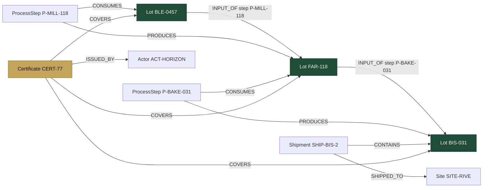

### 4.4 Passages de documents et embeddings

Les textes de certificats et d'audits de la table `documents` sont découpés en paragraphes. Chaque paragraphe devient un `Chunk` avec les ids qu'il mentionne (`entity_ids`), pour qu'un résultat textuel puisse être relié au graphe. En mode mock, l'embedding est un vecteur de hachage de 64 dimensions ([`retrieval/embeddings.py`](src/agritrace/retrieval/embeddings.py)) : aucun appel réseau. Dans Neo4j, le même vecteur est stocké dans `Chunk.embedding` et indexé :

```cypher
CREATE VECTOR INDEX chunk_embedding IF NOT EXISTS FOR (c:Chunk) ON (c.embedding)
OPTIONS {indexConfig: { `vector.dimensions`: 64, `vector.similarity_function`: 'cosine' }}
```

Le passage de `CERT-77` (embedding réduit à ses 4 premières valeurs sur 64) :

```json
{
  "id": "CHK-DOC-CERT-77-0",
  "document_id": "DOC-CERT-77",
  "text": "Certificate CERT-77. Scheme: Organic Horizon (fictional). Issuer: Organisme Horizon. Holder: Fournil Lumière. Status: valid. Validity: 2025-04-01 to 2027-12-31. Scope of the batch genealogy: wheat lot BLE-0457 harvested at Ferme des Collines, milled as flour FAR-118 at Moulin du Val, baked as biscuits BIS-031 at Fournil Lumière. The scope is only this wheat, flour, and biscuit genealogy.",
  "entity_ids": ["CERT-77", "BLE-0457", "FAR-118", "BIS-031", "ACT-LUMIERE"],
  "embedding": [-0.2917, 0.1459, 0.0, 0.0, "..."]
}
```

Le jeu de départ contient quatre passages : `CHK-DOC-CERT-77-0`, `CHK-DOC-CERT-78-0`, `CHK-DOC-AUDIT-MILL-0` et `CHK-DOC-RECALL-PLAYBOOK-0`.

### 4.5 Requête GraphRAG

Une question part dans deux directions à la fois. La partie structurelle est traitée par un parcours de graphe et, pour les régulateurs et les auditeurs, par un brouillon text-to-Cypher qui doit passer [`validate_cypher`](src/agritrace/security/cypher_guard.py). La partie textuelle est traitée par la recherche de passages. La réponse est ensuite construite uniquement à partir de ces deux résultats.

Question : `Trace BIS-031 upstream`. Le Cypher rédigé (rédacteur mock) après le garde-fou, et les lignes renvoyées :

```json
{
  "ok": true,
  "cypher": "MATCH (origin:Lot)-[:INPUT_OF*1..6]->(lot:Lot {id: $lot_id})\nRETURN origin.id AS origin_lot, lot.id AS lot_id\nLIMIT 25",
  "params": {"lot_id": "BIS-031"},
  "error": "",
  "rows": [
    {"origin_lot": "FAR-118", "lot_id": "BIS-031"},
    {"origin_lot": "BLE-0457", "lot_id": "BIS-031"}
  ]
}
```

Une tentative d'écriture ne s'exécute jamais. `validate_cypher("MATCH (l:Lot) DETACH DELETE l RETURN l LIMIT 5")` lève :

```text
CypherRejected: only a read-only MATCH query is allowed
```

Le parcours de graphe lui-même (`store.trace("BIS-031", "upstream")`, raccourci) :

```json
{
  "root_lot_id": "BIS-031", "direction": "upstream", "product_name": "Biscuits sablés",
  "path_lot_ids": ["BLE-0457", "FAR-118", "BIS-031"],
  "upstream_lot_ids": ["FAR-118", "BLE-0457"],
  "process_ids": ["P-BAKE-031", "P-COMM-0457", "P-MILL-118"],
  "shipment_ids": ["SHIP-BIS-1", "SHIP-BIS-2"],
  "certificate_ids": ["CERT-77"],
  "origin_actor_name": "Ferme des Collines",
  "retail_sites": ["Épicerie Rive (SITE-RIVE)"]
}
```

La recherche de passages pour `Which certificate covers the biscuits and the wheat genealogy?` renvoie en premier le passage de `CERT-77` (`"score": 0.1552`), dont les `entity_ids` le relient aux trois lots.

### 4.6 L'état LangGraph, nœud par nœud

L'état du workflow est le dictionnaire typé `GraphState` de [`agents/graph.py`](src/agritrace/agents/graph.py). Chaque nœud ne renvoie que les clés qu'il modifie, et le checkpointer `MemorySaver` conserve l'état du fil entre l'interruption et la reprise. Voici les mises à jour réelles pour `What is the downstream recall impact of BLE-0457?` (raccourcies).

Entrée :

```json
{"question": "What is the downstream recall impact of BLE-0457?",
 "principal": {"role": "regulator", "actor_id": null, "name": "Demo regulator"},
 "status": "running", "citations": [], "injection_flags": [], "documents": []}
```

Après `route` : l'id du lot est extrait du texte et le contrôle d'accès passe.

```json
{"route": "recall", "lot_id": "BLE-0457", "direction": "downstream",
 "certificate_id": null, "injection_flags": [], "status": "running"}
```

Après `recall` : la trace, la conformité et une proposition sont enregistrées. Rien n'est encore émis.

```json
{"trace": {"root_lot_id": "BLE-0457", "downstream_lot_ids": ["FAR-118", "BIS-031"], "...": "..."},
 "compliance": {"lot_id": "BLE-0457", "compliant": true, "certificate_ids": ["CERT-77"], "flags": []},
 "recall_proposal": {"root_lot_id": "BLE-0457", "downstream_lot_ids": ["FAR-118", "BIS-031"],
   "retail_sites": ["Épicerie Rive (SITE-RIVE)"], "shipment_ids": ["SHIP-BIS-1", "SHIP-BIS-2"],
   "certificate_note": "CERT-77 is still valid until 2027-12-31.", "certificate_ids": ["CERT-77"]},
 "citations": [{"kind": "node", "id": "BLE-0457", "label": "Lot", "detail": "lineage"}, "..."],
 "status": "needs_approval"}
```

À `approval` : le graphe s'arrête sur `interrupt(...)` et attend. Le flux émet une mise à jour `__interrupt__` dont `Interrupt.value` vaut :

```json
{"type": "recall_approval",
 "question": "Approve this recall recommendation? Reply approve or reject.",
 "proposal": {"root_lot_id": "BLE-0457", "downstream_lot_ids": ["FAR-118", "BIS-031"], "...": "..."}}
```

Après la reprise avec `approve` (régulateur) :

```json
{"human_decision": "approve", "approval_note": "", "status": "running"}
```

Après `compose` :

```json
{"answer": "Recall issued for BLE-0457. Affected lots: FAR-118, BIS-031. Approved by regulator.\n\nMock LLM: the grounded answer above is the system of record for this demo.",
 "citations": ["... same 16 ids as above ..."], "status": "complete"}
```

Sur la route `trace`, le chemin est plus court : `route` fixe `"route": "trace", "direction": "upstream"`, puis `trace` ajoute le résultat `trace` montré en 4.5, puis `compose` rédige la réponse.

### 4.7 Appels d'outils MCP et carte A2A

Les trois outils MCP de [`mcp/server.py`](src/agritrace/mcp/server.py) appellent le même service que l'API et renvoient des chaînes JSON. Un `actor_id` vide désigne le régulateur de démo. Les mêmes règles d'accès par ligne s'appliquent : un distributeur qui demande un lot qu'il n'a jamais reçu obtient une erreur, pas des données.

`trace_lot(lot_id="BIS-031", direction="upstream")` renvoie le résultat de trace montré en 4.5.

`check_certificates(lot_id="BIS-031")`:

```json
{"lot_id": "BIS-031", "as_of": "2026-11-13", "compliant": true, "schemes": ["Organic Horizon"],
 "product_name": "Biscuits sablés", "site_name": "Fournil Lumière", "site_id": "SITE-LUMIERE",
 "upstream_lot_ids": ["FAR-118", "BLE-0457"], "certificate_ids": ["CERT-77"],
 "certificate_summaries": ["CERT-77 (Organic Horizon, status valid, valid_to 2027-12-31)"], "flags": []}
```

`search_documents(query="mixed lots mill audit", k=1)`:

```json
[{"id": "CHK-DOC-AUDIT-MILL-0", "document_id": "DOC-AUDIT-MILL",
  "text": "Mill audit AUD-MILL-2026 of Moulin du Val (SITE-VAL), 2026-09-12. Auditor: Atelier Audit Nord. Result: major_nonconformity. Finding: process P-MIX-221 mixed wheat BLE-0881, covered only by expired certificate CERT-78, with wheat BLE-0902. ...",
  "entity_ids": ["AUD-MILL-2026", "FAR-221", "BLE-0881", "BLE-0902", "CERT-78", "SITE-VAL", "P-MIX-221"],
  "score": 0.0972}]
```

`trace_lot(lot_id="OIL-009", actor_id="ACT-RIVE")`:

```json
{"error": "retailer cannot access lot OIL-009", "lot_id": "OIL-009"}
```

Carte A2A sur `GET /.well-known/agent-card.json` ([`a2a/card.py`](src/agritrace/a2a/card.py), raccourcie) :

```json
{"protocol": "a2a-minimal-0.1", "name": "AgriTrace recall assistant",
 "url": "http://127.0.0.1:8000/a2a/tasks", "version": "0.1.0",
 "capabilities": {"streaming": false, "humanInTheLoop": true},
 "skills": [{"id": "trace_lot", "name": "Trace a lot"},
            {"id": "check_certificates", "name": "Check certificates"},
            {"id": "search_documents", "name": "Search documents"}]}
```

Réponse de `POST /a2a/tasks` avec la tâche `t-77` de la section 9 (citations raccourcies) :

```json
{"protocol": "a2a-minimal-0.1", "id": "t-77", "status": "complete",
 "message": {"role": "agent", "parts": [{"type": "text", "text": "Upstream trace of BIS-031 (Biscuits sablés).\nLots: BLE-0457, FAR-118, BIS-031.\n..."}]},
 "citations": [{"kind": "node", "id": "BLE-0457", "label": "Lot", "detail": "lineage"}, "..."]}
```

### 4.8 Réponse finale sourcée, avec citations

`POST /ask` renvoie un `AskResponse`. Le texte est produit à partir des résultats d'outils, chaque citation est un id renvoyé par un outil, et la ligne de récit mock est contrôlée pour ne pas pouvoir ajouter d'ids. Pour un régulateur, la réponse contient aussi le Cypher protégé et ses lignes, et chaque appel reçoit un id d'événement d'audit.

```json
{
  "status": "complete",
  "route": "trace",
  "answer": "Upstream trace of BIS-031 (Biscuits sablés).\nLots: BLE-0457, FAR-118, BIS-031.\nPath: BLE-0457 -> FAR-118 -> BIS-031.\nOrigin: BLE-0457 at Ferme des Collines (SITE-COLLINES), actor ACT-COLLINES.\nCertificates: CERT-77.\nRetail sites: Épicerie Rive (SITE-RIVE).\nShipments: SHIP-BIS-1, SHIP-BIS-2.\n\nMock LLM: the grounded answer above is the system of record for this demo.",
  "citations": [
    {"kind": "node", "id": "BLE-0457", "label": "Lot", "detail": "lineage"},
    {"kind": "node", "id": "FAR-118", "label": "Lot", "detail": "lineage"},
    {"kind": "node", "id": "BIS-031", "label": "Lot", "detail": "lineage"},
    {"kind": "node", "id": "SITE-COLLINES", "label": "Site", "detail": "place"},
    {"kind": "node", "id": "CERT-77", "label": "Certificate", "detail": "coverage"},
    {"kind": "node", "id": "SHIP-BIS-1", "label": "Shipment", "detail": "movement"},
    "..."
  ],
  "recall_proposal": null,
  "cypher": {"ok": true, "params": {"lot_id": "BIS-031"}, "rows": [{"origin_lot": "FAR-118", "lot_id": "BIS-031"}, {"origin_lot": "BLE-0457", "lot_id": "BIS-031"}], "...": "..."},
  "principal": {"role": "regulator", "actor_id": null, "name": "Demo regulator"},
  "injection_flags": [],
  "audit_event_id": "e4a18b394530",
  "thread_id": "readme-trace"
}
```

`audit_event_id` et `thread_id` changent à chaque exécution.

### 4.9 Format d'un cas d'évaluation

Chaque cas de [`src/agritrace/eval/dataset.json`](src/agritrace/eval/dataset.json) indique le statut attendu, les ids et phrases qui doivent apparaître (dans la réponse ou les citations), et ceux qui ne doivent pas apparaître. Ce sont les ids interdits qui détectent un mauvais parcours, par exemple la farine mélangée `FAR-221` qui fuirait dans la trace des biscuits.

```json
{
  "id": "recall-wheat",
  "question": "What is the downstream recall impact of BLE-0457?",
  "status": "needs_approval",
  "expect_ids": ["BLE-0457", "FAR-118", "BIS-031", "CERT-77", "SITE-RIVE"],
  "expect_phrases": ["pending human approval", "FAR-118", "BIS-031", "CERT-77"],
  "forbid_ids": ["FAR-221", "OIL-009"],
  "forbid_phrases": ["Recall issued"]
}
```

Sortie de `python -m agritrace.eval.runner` :

```text
eval 7/7
  ok upstream-biscuits status=complete
  ok downstream-wheat status=complete
  ok cert-77-biscuits status=complete
  ok recall-wheat status=needs_approval
  ok expired-catalog status=complete
  ok mill-audit status=complete
  ok broken-oil status=complete
```

---

## 5. Architecture

### 5.1 Ce que ce dépôt exécute

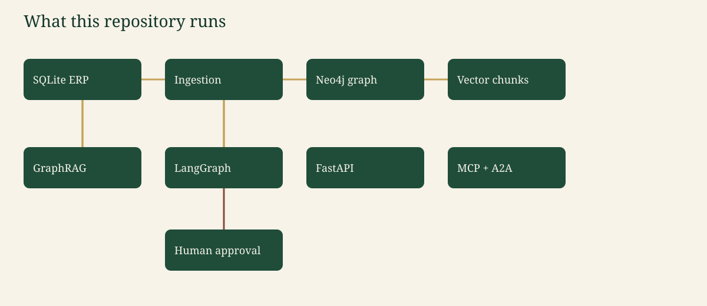

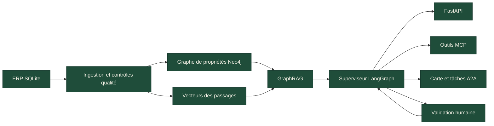

| Brique | Rôle dans ce dépôt |
| --- | --- |
| ERP SQLite | Système de référence pour les acteurs, lots, événements, certificats et textes de documents. [`src/agritrace/data/schema.sql`](src/agritrace/data/schema.sql) |
| Ingestion | Contrôle qualité, écriture SQL, relecture SQL, projection dans le graphe. [`src/agritrace/service.py`](src/agritrace/service.py) |
| Neo4j | Contraintes, généalogie `INPUT_OF`, index vectoriel. Utilisé quand `GRAPH_BACKEND=neo4j`. |
| Graphe en mémoire | Mêmes réponses sans Docker. C'est ce que la CI exécute. |
| GraphRAG | Parcours de graphe + recherche dans les passages. |
| LangGraph | Aiguillage, outils, checkpointer, interruption. |
| FastAPI | `/ask`, `/lots/...`, `/cypher` ; MCP est un processus stdio séparé, A2A passe par HTTP. |
| Humain | Obligatoire avant que le texte « Recall issued » (rappel émis) soit produit. |

### 5.2 Contexte, conteneurs, déploiement

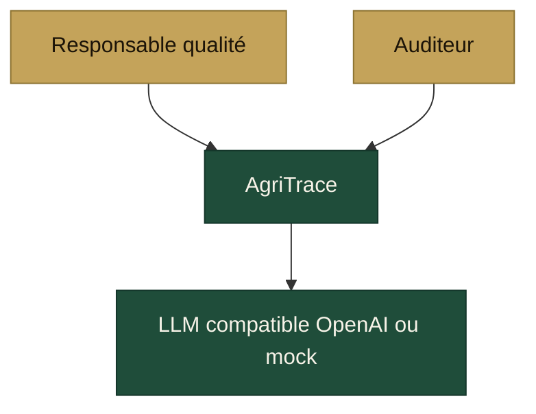

`compose.yaml` lance Neo4j 5.26 et l'API. Les ports navigateur sont liés à `127.0.0.1`. Dans le conteneur, l'API écoute sur `0.0.0.0:$PORT`. La CI ne démarre pas Docker : elle fixe `GRAPH_BACKEND=memory` et `LLM_MODE=mock`.

### 5.3 Séquence : tracer, puis un rappel qui attend

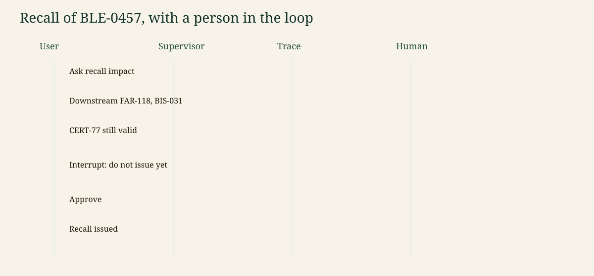

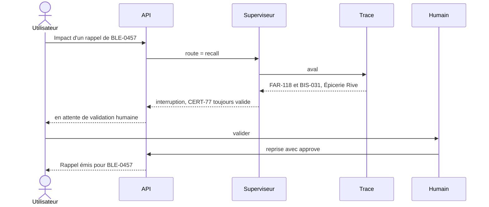

Tant que la reprise n'a pas eu lieu, la réponse indique **en attente** (`pending`) et ne dit **pas** que le rappel a été émis.

### 5.4 Architecture cible pour un organisme de certification

C'est une **cible**, pas le déploiement de ce dépôt. Le dépôt en est la tranche de référence (un fichier SQL, un graphe, un processus, un modèle mock).

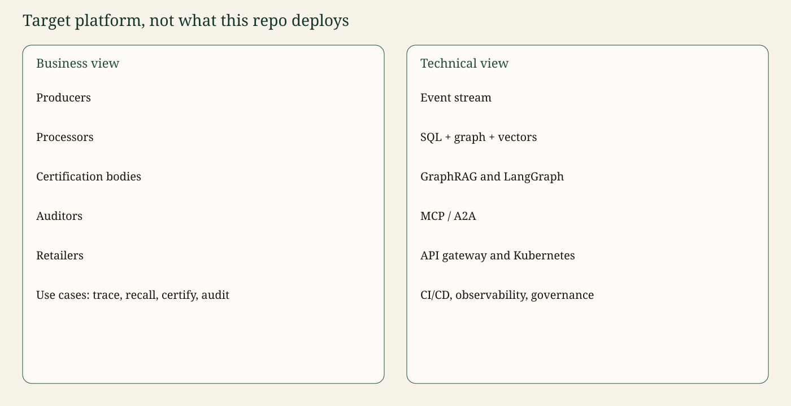

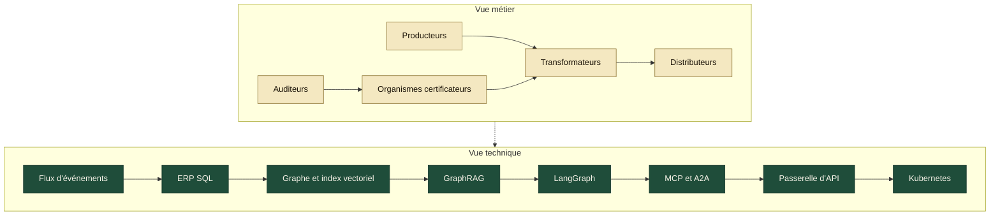

| Cas d'usage métier | Chemin technique |
| --- | --- |
| Tracer un lot | Événement du flux ou de l'ERP → parcours `INPUT_OF` |
| Rappel | Fermeture vers l'aval, proposition, tâche humaine, puis message aux distributeurs |
| Certifier | Nœud Certificat avec `valid_from` / `valid_to`, relié aux lots |
| Auditer | Rapport non structuré découpé, vectorisé, relié au site et aux lots |

Transverse sur la plateforme cible : une passerelle d'API avec une vraie gestion d'identité, une sécurité au niveau des lignes appliquée dans la requête de graphe, un journal d'audit en ajout seul, OpenTelemetry vers un collecteur, des contrôles de politique sur la passerelle LLM et une CI/CD qui promeut les versions d'ontologie. La section 10 donne la liste des contrôles. La section 17 indique lesquels ne sont qu'esquissés ici.

---

## 6. Ontologie et schéma du graphe

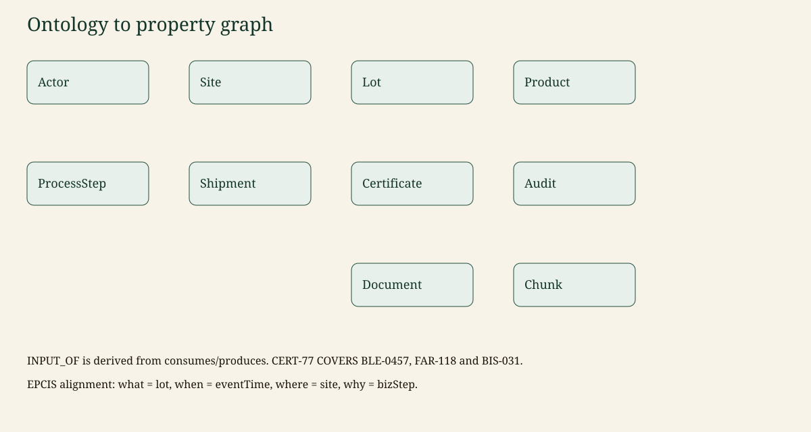

Classes dans [`ontology/traceability.ttl`](ontology/traceability.ttl) : Actor (acteur), Site, Product (produit), Ingredient (ingrédient), Lot, ProcessStep (mise en circulation ou transformation), Shipment (expédition), Certificate (certificat), Audit, Document, Chunk (passage).

| Relation | De → vers | Équivalent EPCIS |
| --- | --- | --- |
| `OPERATES` | Actor → Site | partie qui exploite le lieu |
| `PRODUCED_AT` | Lot → Site | bizLocation |
| `OF_PRODUCT` | Lot → Product | classe d'article commercial |
| `CONSUMES` / `PRODUCES` | ProcessStep → Lot | quantités en entrée et en sortie |
| `INPUT_OF` | Lot → Lot | généalogie dérivée, pas un second événement |
| `CONTAINS`, `SHIPPED_FROM`, `SHIPPED_TO` | Shipment | expédition |
| `COVERS` | Certificate → Lot, Site ou Actor | hors du cœur d'EPCIS |
| `ISSUED_BY` / `HELD_BY` | Certificate → Actor | |
| `AUDITS` / `EVIDENCES` | Audit → Site / Certificate | |
| `PART_OF` / `MENTIONS` | Chunk → Document / entité | recherche |

Règles codées dans la fonction de conformité, et pas seulement décrites en texte :

- Une étape de **mise en circulation** peut n'avoir aucun lot en entrée (une récolte).
- Une **transformation** sans lot en entrée est `broken_chain` (chaîne rompue, `OIL-009`).
- Une transformation dont les intrants n'ont pas le même état de certification est `mixed_lots` (lots mélangés, `FAR-221`).
- Un référentiel revendiqué exige un certificat qui le couvre avec `valid_from ≤ as_of ≤ valid_to`. `CERT-78`, périmé, ne compte pas.
- `CERT-77` couvre `BLE-0457`, `FAR-118` et `BIS-031` : le lot de biscuits est donc conforme au 2026-11-13.

Les contraintes Neo4j (un `id` unique par label) sont dans [`src/agritrace/graph/schema.py`](src/agritrace/graph/schema.py) :

```cypher
CREATE CONSTRAINT lot_id IF NOT EXISTS FOR (n:Lot) REQUIRE n.id IS UNIQUE
```

Exemple de requête de lecture pour la chaîne fil rouge :

```cypher
MATCH (wheat:Lot {id: 'BLE-0457'})-[:INPUT_OF]->(flour:Lot {id: 'FAR-118'})
      -[:INPUT_OF]->(biscuits:Lot {id: 'BIS-031'})
MATCH (cert:Certificate {id: 'CERT-77'})-[:COVERS]->(biscuits)
RETURN wheat.id AS wheat, flour.id AS flour, biscuits.id AS biscuits, cert.id AS certificate
LIMIT 5
```

Le garde-fou Cypher accepte cette requête. Le moteur en mémoire renvoie la ligne de l'exemple. Neo4j exécute le même texte après l'ingestion.

---

## 7. Agents

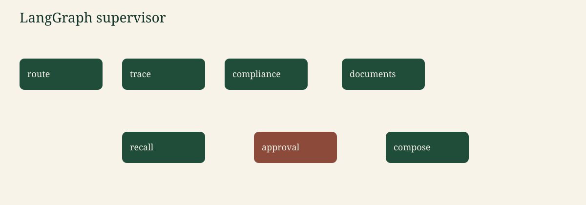

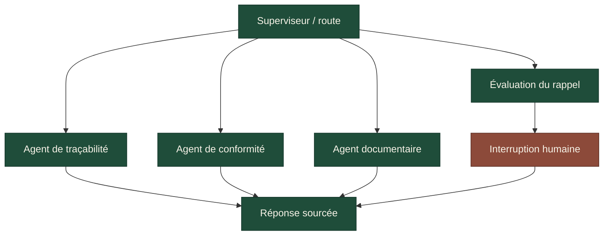

| Nœud | Rôle |
| --- | --- |
| Superviseur | Des mots-clés en anglais ou en français choisissent `trace`, `compliance`, `documents` ou `recall`, ainsi que l'amont ou l'aval. Un identifiant de lot présent dans la question (`BLE-0457`, `FAR-118`, `BIS-031`, `OIL-009`) est extrait, jamais deviné. |
| Traçabilité | Parcourt `INPUT_OF` vers l'amont et/ou l'aval. Cite les lots, sites, acteurs, expéditions et certificats. |
| Conformité | Remonte l'amont d'un lot et applique les règles de certification. Sans lot, liste les certificats périmés. Avec seulement `CERT-77`, renvoie son périmètre. |
| Documents | Recherche hybride dans le texte des certificats et des audits, puis un saut dans le graphe depuis un lot mentionné. |
| Rappel | Fermeture vers l'aval plus la note sur le certificat. Rédige la proposition. Ne l'émet pas. |
| Validation | `interrupt(...)`. Le checkpointer conserve le fil. Reprise avec `approve` ou `reject`. Seul le rôle **régulateur** peut valider. |
| Composition | Transforme les résultats d'outils en réponse avec citations. Le récit mock ne peut pas ajouter de nouveaux identifiants. |

L'état typé est `GraphState` dans [`src/agritrace/agents/graph.py`](src/agritrace/agents/graph.py) : question, route, id du lot, sens, appelant, trace, conformité, documents, citations, proposition de rappel, décision humaine, réponse, statut, signaux d'injection.

Le checkpointer est l'enregistreur en mémoire de LangGraph (`MemorySaver`). Il est local au processus : un redémarrage oublie les fils. C'est acceptable pour la démo et c'est indiqué dans la feuille de route.

L'interruption se trouve dans le nœud de validation, **après** l'enregistrement de la proposition et **avant** que la composition écrive « Recall issued ».

---

## 8. Recherche (retrieval)

La recherche hybride, c'est deux outils, puis un paragraphe sourcé.

1. **Graphe.** `trace` / `check_lot` dans [`src/agritrace/graph/lineage.py`](src/agritrace/graph/lineage.py). Exact. Utilisé pour l'amont de `BIS-031` et pour `CERT-77`.
2. **Vecteurs.** Les paragraphes des documents deviennent des nœuds `Chunk` avec un embedding par hachage de 64 dimensions en mode mock (ou un appel `/embeddings` compatible OpenAI quand `LLM_MODE=openai`). La recherche combine la similarité cosinus et le recouvrement de mots, pour que l'audit du moulin arrive en tête sur « mixed » sans appel réseau. Neo4j stocke le même vecteur dans l'index `chunk_embedding`.
3. **Text-to-Cypher.** Un prompt LangChain contient la fiche du schéma. Le mode mock produit l'un de quelques modèles `MATCH`. Chaque requête passe par [`validate_cypher`](src/agritrace/security/cypher_guard.py) avant exécution : une seule instruction, commence par `MATCH`, contient `RETURN`, pas de `CREATE` / `DELETE` / `SET` / `CALL`, labels et types de relations pris dans la liste autorisée, `LIMIT` de 50 au maximum.

Les limites des garde-fous, dites simplement :

- Le garde-fou ne prouve pas que la requête est la meilleure. Il prouve qu'elle ne peut pas écrire.
- Le moteur en mémoire exécute les modèles connus, dont la requête `INPUT_OF` de l'exemple. Les lectures arbitraires tournent sur Neo4j.
- Le texte de l'utilisateur est une donnée. Les motifs comme « ignore previous instructions » sont journalisés et la question n'est pas transmise au modèle qui rédige le récit. La trace s'exécute quand même sur l'id de lot extrait.
- Les citations sont des identifiants renvoyés par les outils. Un récit qui introduit un nouvel identifiant est écarté.

---

## 9. Outils

| Outil | Ce que c'est | Pourquoi il est là | Où |
| --- | --- | --- | --- |
| Neo4j, Cypher, index vectoriel | Graphe de propriétés et index cosinus | Requêtes de généalogie et recherche de passages | `graph/schema.py`, `graph/neo4j_store.py` |
| OWL, Turtle, rdflib | Fichier de vocabulaire et parseur | Catalogue de classes versionné | `ontology/traceability.ttl` |
| GS1 EPCIS (idées seulement) | Questions quoi / quand / où / pourquoi | Garde un modèle familier aux lecteurs supply chain | commentaires de l'ontologie |
| SQLite (SQL compatible Postgres) | Extrait ERP | Montre où les données relationnelles restent à leur place | `data/schema.sql`, `data/erp.py` |
| Python 3.11, Pydantic | Langage et enregistrements | Lots, certificats et corps d'API typés | `models.py` |
| LangChain (`langchain-core`) | Modèles de prompts | Prompt Cypher ancré sur le schéma, prompt de récit | `llm/provider.py` |
| LangGraph | Workflow à état | Superviseur, interruption, checkpointer | `agents/graph.py` |
| SDK MCP | Protocole d'outils | `trace_lot`, `check_certificates`, `search_documents` | `mcp/server.py` |
| A2A (minimal) | Carte d'agent + POST de tâche | Un exemple étiqueté, pas une pile complète | `a2a/card.py` |
| FastAPI | API HTTP | Question, reprise, trace, Cypher, santé | `api/main.py` |
| Streamlit | Petite interface | Poser une question en tant qu'acteur, valider un rappel | `ui/streamlit_app.py` |
| OpenTelemetry | Traces | Spans sur l'ingestion, la trace, la recherche, la question | `observability/otel.py` |
| LangSmith | Traces hébergées, optionnelles | Désactivé sauf si `LANGCHAIN_TRACING_V2=true` | variables d'environnement |
| LLM compatible OpenAI / mock | Chat et embeddings | Le mock est le défaut et le chemin de la CI | `llm/provider.py` |
| Docker Compose | Neo4j + API | Pile locale en une commande | `compose.yaml` |
| pytest | Tests | Chaîne de l'exemple, RBAC, interruption, HTTP | `tests/` |
| GitHub Actions | CI | Ruff, mypy, pytest, éval, mode mock | `.github/workflows/ci.yml` |
| uv, ruff, mypy | Environnement, lint, types | `uv` optionnel ; ruff et mypy tournent en CI | `pyproject.toml` |
| Mermaid | Schémas en Markdown | Rendu natif sur GitHub | ce README |

<details>
<summary>Neo4j, Cypher et l'index vectoriel</summary>

**Quoi.** Un graphe de propriétés avec labels. Cypher est le langage de requête. Un index vectoriel sur `Chunk.embedding` répond aux recherches par similarité.

**Pourquoi.** La généalogie de longueur variable (`INPUT_OF*1..6`) et « quel certificat couvre ce nœud » restent lisibles. Une requête de rappel relationnelle à travers divisions et fusions de lots devient un empilement de jointures.

**Rôle.** `GRAPH_BACKEND=neo4j` fusionne (MERGE) l'extrait ERP, crée les contraintes d'unicité et construit `chunk_embedding`. Les calculs de trace utilisés par les agents passent par le moteur Python partagé, pour que la CI et Neo4j ne divergent pas. Neo4j exécute quand même le Cypher protégé, et c'est la base qu'on ouvre dans Neo4j Browser.

**Alternative étudiée.** Un triplestore RDF seul (le fichier d'ontologie servirait aussi de stockage des instances). Écarté pour cette charge de parcours. Des CTE récursives PostgreSQL pourraient exprimer une chaîne ; elles deviennent pénibles dès que les expéditions, certificats et passages entrent dans la question.

</details>

<details>
<summary>OWL, Turtle, rdflib et les idées d'EPCIS</summary>

**Quoi.** Le vocabulaire est de l'OWL écrit en Turtle. rdflib le charge pour `GET /ontology`.

**Pourquoi.** Le catalogue a une version (`owl:versionInfo "0.1.0"`) recopiée sur les nœuds du graphe à l'ingestion (`ontology_version`). On peut ouvrir le fichier dans Protégé pour l'éditer visuellement. La démo n'en a pas besoin.

**Rôle.** Classes et relations de la section 6. Les termes EPCIS (`bizStep`, `eventTime`, lieu métier) sont des propriétés d'annotation, pas un import de l'ontologie GS1.

**Alternative.** Un tableur décrivant les colonnes. Il ne porterait ni les domaines des relations ni un IRI de version.

</details>

<details>
<summary>SQLite et Postgres</summary>

**Quoi.** L'ERP est un schéma SQL : acteurs, sites, produits, lots, entrées et sorties de transformation, expéditions, certificats, audits, documents.

**Pourquoi.** Les données de référence et les mouvements de stock naissent dans des systèmes transactionnels. Le graphe est une projection, pas le grand livre. L'ingestion fait toujours un aller-retour par SQLite avant de charger le graphe, y compris dans les tests.

**Rôle.** [`schema.sql`](src/agritrace/data/schema.sql) utilise des types acceptés par Postgres (`TEXT`, `REAL`, JSON stocké en texte). Le moteur utilisé est SQLite, pour que la CI n'ait pas besoin d'une deuxième base. Une connexion Postgres n'est pas encore branchée (feuille de route).

**Alternative.** Générer seulement du Cypher, sans SQL. Cela cacherait le système de référence que ce projet veut justement montrer.

</details>

<details>
<summary>Python, Pydantic, LangChain, LangGraph</summary>

**Quoi.** Python 3.11. Les modèles Pydantic sont les enregistrements qui survivent à l'aller-retour SQL. LangChain contient les prompts. LangGraph contient le graphe de nœuds.

**Pourquoi.** Des enregistrements typés empêchent un id de lot de changer de forme entre SQL, graphe et JSON. Les prompts restent au même endroit. Le workflow a besoin d'une pause et d'une reprise : c'est exactement le rôle d'un graphe avec checkpointer.

**Rôle.** `Lot`, `Certificate`, `AskResponse` dans `models.py`. `CYPHER_PROMPT` et `NARRATIVE_PROMPT`. `build_agent` compile le graphe.

**Extrait.**

```python
CYPHER_PROMPT = ChatPromptTemplate.from_messages(
    [
        ("system", "Write one read-only Cypher query ...\n{schema}"),
        ("human", "{question}"),
    ]
)
```

**Alternative.** Un seul script Python sans bibliothèque de graphe. Il ne montrerait ni checkpoint ni interruption, ce qui est tout l'intérêt du flux de rappel.

</details>

<details>
<summary>MCP et le point d'entrée A2A minimal</summary>

**Quoi.** Trois outils MCP, enregistrés sur `MCPServer` (SDK MCP Python 2.x) :

| Outil | Arguments | Renvoie |
| --- | --- | --- |
| `trace_lot` | `lot_id`, `direction` (`upstream`, `downstream`, `both`), `actor_id` optionnel | généalogie en JSON |
| `check_certificates` | `lot_id`, `actor_id` optionnel | rapport de conformité en JSON |
| `search_documents` | `query`, `k`, `actor_id` optionnel | passages JSON que l'acteur peut voir |

Un `actor_id` vide utilise le régulateur de démo quand `AGRITRACE_DEMO_OPEN=1`. Passer `ACT-RIVE` applique le filtre de lignes de ce distributeur.

**A2A.** `GET /.well-known/agent-card.json` et `POST /a2a/tasks` avec :

```json
{
  "id": "t-77",
  "message": {
    "role": "user",
    "parts": [{"type": "text", "text": "Trace BIS-031 upstream"}]
  }
}
```

Le champ `protocol` de la carte vaut `a2a-minimal-0.1`, pour que personne ne la confonde avec une implémentation complète.

**Alternative.** HTTP seul. MCP est là pour qu'un assistant de bureau puisse appeler les outils sans l'interface de ce dépôt. A2A est là pour qu'un second agent puisse trouver la carte.

</details>

<details>
<summary>FastAPI, Streamlit, OpenTelemetry, LangSmith, la passerelle LLM</summary>

**FastAPI** (`python -m agritrace.api.main`) sert la santé, l'ontologie, les constats qualité, le journal d'audit, `/ask`, `/ask/resume`, la trace d'un lot, sa conformité, la recherche documentaire, `/cypher` protégé, la carte d'agent et les tâches A2A. L'en-tête `X-Actor-Id` choisit l'acteur. Impossible de devenir régulateur en envoyant un en-tête de rôle à côté d'un id de ferme : le rôle de l'acteur vient du graphe.

**Streamlit** (`streamlit run ui/streamlit_app.py`) est le même service avec des boutons, dont valider / rejeter quand le statut est `needs_approval`.

**OpenTelemetry.** `start_span` encadre l'ingestion, la trace, la recherche et la question. `OTEL_EXPORTER=none` (par défaut) installe un provider sans rien exporter. `console` affiche les spans. `otlp` nécessite l'extra optionnel `opentelemetry-exporter-otlp-proto-http` et `OTEL_EXPORTER_OTLP_ENDPOINT`.

**LangSmith.** Pas importé. Si vous fixez `LANGCHAIN_TRACING_V2=true` et une clé, les callbacks de LangChain émettront des traces. Laissez-le à false en CI.

**Passerelle LLM.** `LLM_MODE=mock` ou `openai`. Le mode OpenAI envoie vers `{LLM_BASE_URL}/chat/completions` avec `LLM_MODEL` et `LLM_API_KEY`. Tout hébergeur compatible fonctionne. Les embeddings utilisent `{LLM_BASE_URL}/embeddings` et doivent correspondre à `EMBEDDING_DIM` (64 pour le hachage mock, souvent 1536 pour un modèle hébergé ; recréez l'index Neo4j si vous le changez).

**Alternative.** Le SDK d'un seul fournisseur. Écarté pour que la démo tourne sans clé et que la passerelle puisse viser un autre hébergeur.

</details>

<details>
<summary>Docker Compose, pytest, GitHub Actions, uv, ruff, mypy, Mermaid</summary>

**Compose** fixe `neo4j:5.26.0-community` et construit l'image de l'API. Le mot de passe Neo4j utilise `${NEO4J_PASSWORD:-devpasswordlocal}` ; cette valeur par défaut ne sert qu'en local.

**pytest** couvre la chaîne de l'exemple, l'aller-retour SQL, le refus de Cypher, le jeu d'évaluation, l'interruption du rappel, le refus pour un distributeur, l'injection de prompt, les noms des outils MCP et HTTP.

**La CI**, à chaque push et pull request : Python 3.11, `pip install -e ".[dev]"`, ruff, mypy, pytest, `python -m agritrace.eval.runner`, le tout avec `LLM_MODE=mock`.

**uv** peut créer l'environnement 3.11 (`uv venv --python 3.11`). La CI utilise pip pour rester standard. **ruff** vérifie et formate le code. **mypy** contrôle les types de `src` avec `disallow_untyped_defs`.

**Mermaid** est la source des schémas de ce README (GitHub les affiche). Des copies SVG et PNG pour Confluence sont dans [`docs/assets/`](docs/assets/). Pour les régénérer : `python scripts/render_assets.py`.

</details>

---

## 10. Sécurité et gouvernance

| Contrôle | Ce que la démo fait réellement |
| --- | --- |
| Lignage | Chaque nœud du graphe porte `source_system=erp-sqlite` et `ontology_version=0.1.0` |
| Catalogue | `GET /ontology` liste les classes du fichier Turtle |
| Version de l'ontologie | `owl:versionInfo` dans le fichier TTL. La changer est une modification délibérée, pas un effet de bord |
| Qualité des données | Contrôles référentiels dans `data/quality.py`. Un id orphelin fait échouer le chargement. Les certificats périmés et les chaînes rompues sont des **constats**, car ils font partie du scénario |
| Accès au niveau des lignes | `security/rbac.py`. Un distributeur voit les lots qui lui ont été expédiés et leur amont, pas la marchandise d'un autre distributeur. Un producteur voit l'aval de ce qu'il a produit (obligation de rappel) mais pas l'intrant d'un voisin. Un certificateur voit les lots couverts par ses certificats, plus leur aval. Un auditeur voit les lots des sites qu'il a audités. Le régulateur voit tout |
| Droits sur les outils | `read_cypher` réservé aux auditeurs et au régulateur. `approve_recall` réservé au régulateur |
| Secrets | `.env` est ignoré par git. `.env.example` a des clés vides. Le mot de passe par défaut de Compose est signalé comme local uniquement |
| Données personnelles / RGPD | Le jeu de données ne contient aucune personne réelle. Les noms d'auditeurs et d'entreprises sont fictifs. Les questions sont conservées dans le journal d'audit du processus pour la démo ; en production, le journal devrait garder un hachage ou une version expurgée de la question, avec une durée de conservation. Aucune donnée personnelle n'est envoyée à un modèle en mode mock |
| Injection de prompt | Des motifs (ignorer les instructions, changement de rôle, supprimer le graphe, « ne cite pas ») sont signalés. Le modèle de récit ne voit pas la question brute. Les outils utilisent quand même l'id de lot extrait |
| Cypher en lecture seule | `validate_cypher` refuse les écritures, commentaires, instructions multiples, labels et relations inconnus, et `LIMIT` au-delà de 50 |
| Réponse sourcée | Les réponses sont produites à partir des résultats d'outils. Les citations sont ces identifiants. Un récit qui ajoute un id est remplacé par une note de suppression |
| Journal d'audit | `security/audit_log.py` ajoute chaque question, refus et reprise. `GET /audit`. JSONL optionnel via `AUDIT_LOG_PATH`. La mémoire du processus n'est pas un coffre-fort |
| Humain dans la boucle | Le statut du rappel reste `needs_approval` jusqu'à `/ask/resume` avec `approve` ou `reject` |
| Politique de la passerelle LLM | Mock par défaut. Le mode OpenAI est explicite, température 0, et reste derrière le garde-fou Cypher et le contrôle de sourcing |
| Notes AI Act (UE) | C'est une démo portfolio, pas un système de décision déployé. Une recommandation de rappel qui peut retirer un produit des rayons est le type d'action qui exige un humain : c'est la raison de l'interruption. Transparence : la réponse indique quand le récit a été supprimé et cite les ids du graphe. Ce sont des notes d'ingénierie, pas un avis juridique |
| Supervision | Spans OpenTelemetry. Le point de santé renvoie le mode, l'horloge et les volumes |

L'accès ouvert de démo (`AGRITRACE_DEMO_OPEN=1`) associe un acteur absent au régulateur pour que le démarrage rapide fonctionne. Mettez-le à `0` et l'API renvoie 401 tant que `X-Actor-Id` n'est pas fourni. Ne prenez pas ce comportement par défaut pour un modèle d'authentification.

---

## 11. Choix de conception et limites

<details>
<summary>Le graphe à côté du relationnel, pas à sa place</summary>

Le SQL garde le grand livre (quantités, clés étrangères, corps des documents). Le graphe garde les questions qui parcourent une chaîne. L'ingestion est le contrat entre les deux. Limite : le pilote Postgres n'est pas branché ; le schéma est la partie portable.

</details>

<details>
<summary>GraphRAG hybride plutôt que text-to-Cypher seul</summary>

Une requête générée est un bon outil ponctuel et une mauvaise source de vérité unique. Les agents de traçabilité et de conformité appellent des fonctions déterministes. Le text-to-Cypher est réservé aux questions des régulateurs et des auditeurs et il est refusé dès qu'il n'est pas une lecture. Limite : l'exécuteur en mémoire comprend les modèles émis par le rédacteur mock, pas tous les `MATCH` valides.

</details>

<details>
<summary>Une généalogie Python partagée, Neo4j comme base interrogeable</summary>

Une seule implémentation des règles amont, aval et certificats alimente les tests et l'API. Neo4j reçoit les mêmes faits pour que Browser et le Cypher protégé fonctionnent. Limite : un déploiement tout-Cypher devrait réimplémenter ces règles en procédures. C'est indiqué « en cours », pas « fait ».

</details>

<details>
<summary>Un LLM mock par défaut</summary>

La CI, le jeu d'évaluation et les réponses d'exemple n'appellent pas le réseau et n'inventent pas d'ids de lot. Limite : le récit mock est une phrase fixe. Il montre le point d'accroche, pas la qualité d'un modèle. Passez `LLM_MODE=openai` pour qu'un modèle hébergé formule une réponse, qui ne pourra toujours pas ajouter d'ids.

</details>

<details>
<summary>Décisions consignées en ADR courts</summary>

1. **Neo4j** pour les parcours de généalogie ; OWL reste le vocabulaire. Le tout-RDF rendrait le parcours de rappel plus difficile à lire.
2. **LangGraph** pour un workflow qui se met en pause. Une chaîne simple n'a pas d'interruption propre.
3. **MCP** pour des outils que n'importe quel client peut appeler ; une carte A2A minimale pour que la découverte d'agents soit visible et clairement incomplète.
4. **Recherche hybride** pour que les questions structurelles ne soient pas laissées à la similarité.
5. **Mode mock** pour que le projet tourne et soit évalué sans clé.
6. **Le SQL reste le système de référence.** Le graphe est une projection.
7. **Une personne valide un rappel.** Le modèle propose. Le Cypher en lecture seule est la protection en écriture correspondante côté base.

Le texte complet de chaque décision est aussi dans [`docs/adr/`](docs/adr/) (en anglais).

</details>

---

## 12. Évaluation

[`src/agritrace/eval/dataset.json`](src/agritrace/eval/dataset.json) contient sept questions. Le runner vérifie le statut, les ids attendus (dans la réponse ou les citations), les phrases attendues, les ids interdits et les phrases interdites. Le code de sortie vaut 1 si un cas échoue. `pytest` appelle le même runner.

| Cas | Question | Attendu |
| --- | --- | --- |
| upstream-biscuits | Tracer `BIS-031` vers l'amont | `BLE-0457`, `FAR-118`, Ferme des Collines, `CERT-77`. Pas `FAR-221` |
| downstream-wheat | Aval de `BLE-0457` | `FAR-118`, `BIS-031`, Épicerie Rive |
| cert-77-biscuits | `BIS-031` est-il couvert par `CERT-77` ? | conforme, valid_to 2027-12-31 |
| recall-wheat | Impact d'un rappel de `BLE-0457` | `needs_approval`, pas « Recall issued » |
| expired-catalog | Quels certificats sont périmés ? | `CERT-78` uniquement |
| mill-audit | Qu'a dit l'audit du moulin sur les lots mélangés ? | `major_nonconformity`, `FAR-221`, `CERT-78` |
| broken-oil | La chaîne de `OIL-009` est-elle complète ? | `broken_chain`, Pressoir des Olivettes |

Les questions du jeu sont en anglais, comme dans le fichier. Sur la pile mock, ce jeu obtient **7/7**. Ce score mesure les outils déterministes, pas un modèle hébergé.

---

## 13. Observabilité

Spans actuels :

| Span | Quand |
| --- | --- |
| `ingest.sql_to_graph` | aller-retour ERP et chargement du graphe |
| `graph.trace` | `trace_lot`, attribut `lot.id` |
| `graph.compliance` | vérification des certificats |
| `retrieval.search` | recherche documentaire |
| `agent.ask` | un tour utilisateur, attribut `enduser.role` |

Aucun exportateur n'est configuré sauf si vous l'activez (section 9). Le journal d'audit est la trace métier des décisions ; OpenTelemetry est la trace technique des latences et des erreurs. Ce ne sont pas les mêmes stockages.

---

## 14. Intégration continue

Workflow : [`.github/workflows/ci.yml`](.github/workflows/ci.yml).

À chaque push et pull request, le job :

1. récupère le dépôt,
2. installe Python 3.11 et `pip install -e ".[dev]"`,
3. lance `ruff check` et `ruff format --check` sur `src`, `tests` et `ui`,
4. lance `mypy src`,
5. lance `pytest`,
6. lance `python -m agritrace.eval.runner`.

Environnement des étapes 5 et 6 : `LLM_MODE=mock`, `GRAPH_BACKEND=memory`, `AGRITRACE_AS_OF=2026-11-13`. Pas de clé d'API. Pas de service Neo4j. Docker n'est pas nécessaire pour que le badge passe au vert.

---

## 15. Démarrage rapide

### Docker Compose (Neo4j + API)

Le mot de passe Neo4j vaut `devpasswordlocal` par défaut, pour cette pile locale uniquement. Mettez une vraie valeur dans `.env` si le port est accessible à d'autres personnes.

```bash
cp .env.example .env
docker compose up --build -d
docker compose exec app python -m agritrace.ingest
docker compose exec app python -m agritrace.demo
```

API : `http://127.0.0.1:8000/health`. Neo4j Browser : `http://127.0.0.1:7474` (utilisateur `neo4j`).

`ingest` charge l'extrait ERP si vous voulez lancer cette étape seule. L'API le charge aussi au démarrage. `demo` affiche les questions de la section 16.

### La même démo sans Docker (ce que la CI exécute)

```bash
uv venv --python 3.11 && source .venv/bin/activate
uv pip install -e ".[dev]"
make demo
make test
```

`make api` sert FastAPI sur le port 8000. `make ui` sert Streamlit sur le port 8501. `make eval` affiche le score des sept cas.

Serveur MCP en stdio : `python -m agritrace.mcp.server`.

---

## 16. Exemples de questions et de réponses

Capturés depuis `python -m agritrace.demo` en mode mock. La démo répond en anglais : les blocs ci-dessous sont recopiés tels quels, avec une traduction de la question. La ligne de récit est celle du modèle mock. Les paragraphes au-dessus sont la sortie sourcée des outils.

### Remonter les biscuits vers l'amont

**Q.** Trace BIS-031 upstream (tracer BIS-031 vers l'amont)

**Statut.** `complete` / `trace`

```text
Upstream trace of BIS-031 (Biscuits sablés).
Lots: BLE-0457, FAR-118, BIS-031.
Path: BLE-0457 -> FAR-118 -> BIS-031.
Origin: BLE-0457 at Ferme des Collines (SITE-COLLINES), actor ACT-COLLINES.
Certificates: CERT-77.
Retail sites: Épicerie Rive (SITE-RIVE).
Shipments: SHIP-BIS-1, SHIP-BIS-2.
```

### Où est allé le blé

**Q.** Which lots are downstream of wheat lot BLE-0457? (quels lots sont en aval du lot de blé BLE-0457 ?)

```text
Downstream trace of BLE-0457 (Blé tendre).
Lots: BLE-0457, FAR-118, BIS-031.
Path: BLE-0457 -> FAR-118 -> BIS-031.
Certificates: CERT-77.
Retail sites: Épicerie Rive (SITE-RIVE).
```

### CERT-77 est-il encore valide pour les biscuits ?

**Q.** Is biscuit lot BIS-031 covered by CERT-77, and is that certificate valid on 2026-11-13?

```text
BIS-031 is compliant for Organic Horizon as of 2026-11-13.
Covering certificates: CERT-77 (Organic Horizon, status valid, valid_to 2027-12-31).
Upstream lots walked: FAR-118, BLE-0457.
No expired certificate on this chain.
Production site: Fournil Lumière (SITE-LUMIERE).
```

### Le rappel, puis une personne

**Q.** What is the downstream recall impact of BLE-0457? (quel est l'impact aval d'un rappel de BLE-0457 ?)

**Statut.** `needs_approval`

```text
Recall recommendation pending human approval. No recall has been issued.
Root lot: BLE-0457.
Downstream lots: FAR-118, BIS-031.
Affected retail sites: Épicerie Rive (SITE-RIVE).
Certificate note: CERT-77 is still valid until 2027-12-31.
A human must approve before this recommendation is issued.
```

**Reprise.** `approve` en tant que régulateur.

```text
Recall issued for BLE-0457. Affected lots: FAR-118, BIS-031. Approved by regulator.
```

Le fait que `CERT-77` soit valide ne fait pas sauter l'interruption. Demander un rappel produit une recommandation, et une personne doit encore l'émettre. La ligne de farine mélangée n'apparaît pas dans cette liste d'impact.

### Autres questions affichées par la démo

| Question | Résultat |
| --- | --- |
| Quels certificats sont périmés ? | `CERT-78`, Ferme Brume, valid_to 2026-03-01. `CERT-77` n'en fait pas partie. |
| Qu'a dit l'audit du moulin sur les lots mélangés ? | Passage `CHK-DOC-AUDIT-MILL-0` : `major_nonconformity`, `P-MIX-221` a mélangé `BLE-0881` (`CERT-78`) avec `BLE-0902` pour produire `FAR-221`. |
| Où `OIL-009` a-t-il été produit et la chaîne est-elle complète ? | `non-compliant`, `broken_chain`, Pressoir des Olivettes, aucun lot source. |

Un distributeur de l'Épicerie Rive (`ACT-RIVE`) peut tracer `BIS-031` mais pas `OIL-009` : l'API renvoie 403.

---

## 17. Feuille de route

**Fait dans ce dépôt**

- Ontologie 0.1.0 et correspondance inspirée d'EPCIS
- Jeu de données fictif avec `BLE-0457`, `FAR-118`, `BIS-031`, `CERT-77`, plus les lots d'anomalies
- ERP SQLite, contrôles qualité, ingestion SQL → graphe
- Graphe en mémoire et contraintes Neo4j, `INPUT_OF`, index vectoriel
- Recherche hybride, text-to-Cypher ancré sur le schéma, garde-fou en lecture seule
- Superviseur LangGraph, trois chemins spécialisés, checkpointer, interruption avant rappel
- Outils MCP, carte A2A étiquetée et point d'entrée de tâches
- LLM mock et passerelle compatible OpenAI
- Points d'accroche OpenTelemetry et variables LangSmith optionnelles
- Jeu d'évaluation à 7/7 en mode mock, pytest, ruff, mypy, GitHub Actions
- Accès au niveau des lignes, journal d'audit des décisions, signaux d'injection, citations sourcées

**En cours (non présenté comme fait)**

- Postgres comme service ERP en fonctionnement (le schéma est portable ; le pilote n'est pas branché)
- Import complet EPCIS 2.0 en JSON-LD
- Règles de certification implémentées uniquement en procédures Neo4j
- OIDC devant `X-Actor-Id`, et filtres de lignes poussés dans le Cypher
- Stockage d'audit en ajout seul avec durée de conservation, au lieu de la mémoire du processus
- Un tableau de bord LangSmith hébergé
- Un cycle de vie complet des tâches A2A (cette carte est l'exemple minimal)
- Un processus de publication de l'ontologie au-delà de la modification de `owl:versionInfo`

---

Pages qui reprennent ce README pour d'autres canaux : [résumé français](docs/fr/README_fr.md), [concepts](docs/fr/concepts.md), [architecture](docs/fr/architecture.md), [outils](docs/fr/outils.md), [sécurité et gouvernance](docs/fr/securite-gouvernance.md), [architecture cible](docs/fr/architecture-cible.md) ; en anglais : [ontologie](docs/ontology.md), [agents](docs/agents.md), [recherche](docs/retrieval.md), [évaluation](docs/evaluation.md), [ADR](docs/adr/) ; [HTML pour Confluence](docs/confluence/).
