# AgriTrace

[](https://github.com/MourabitElBachir/traceability-graph-agents/actions/workflows/ci.yml)


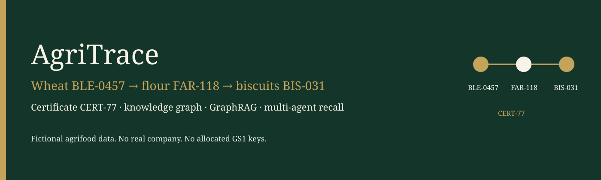

Portfolio project for **El Bachir Mourabit** (Senior Data Engineer / AI architect).

It shows a production-shaped way to trace a food lot and check its certificates: a small ontology, a SQL extract, a property graph, hybrid retrieval, and a multi-agent workflow that stops for a person before it recommends a recall.

**All data is fictional.** Farms, mills, certificates, auditors, and scheme names were invented for this repository. No client is named. Identifiers such as `DEMO-GLN-*` are not allocated GS1 keys.

The same material is split under [`docs/`](docs/), [`docs/fr/`](docs/fr/), and [`docs/confluence/`](docs/confluence/) so it can be published elsewhere. This README is the canonical copy.

## Contents

1. [Business context](#1-business-context)
2. [Concepts in plain language](#2-concepts-in-plain-language)
3. [The running example](#3-the-running-example)
4. [Architecture](#4-architecture)
5. [Ontology and graph schema](#5-ontology-and-graph-schema)
6. [Agents](#6-agents)
7. [Retrieval](#7-retrieval)
8. [Tools](#8-tools)
9. [Security and governance](#9-security-and-governance)
10. [Design choices and limits](#10-design-choices-and-limits)
11. [Evaluation](#11-evaluation)
12. [Observability](#12-observability)
13. [Continuous integration](#13-continuous-integration)
14. [Quickstart](#14-quickstart)
15. [Example questions and answers](#15-example-questions-and-answers)
16. [Roadmap](#16-roadmap)
17. [Résumé en français](#17-résumé-en-français)

---

## 1. Business context

A quality lead, an auditor, or a retailer needs two answers about a batch:

1. **Trace.** Where did this lot come from, and where did it go?
2. **Certify.** Which certificates cover that chain, and are they still valid?

On a recall, the same questions run downstream: which flour and which biscuits were made from this wheat, which shop received them, and has a person actually approved the recommendation?

The running chain in this repository is short on purpose:

```text
wheat BLE-0457  →  flour FAR-118  →  biscuits BIS-031
covered by certificate CERT-77 (Organic Horizon, fictional, valid through 2027-12-31)
```

A second, separate line exists so the compliance agent has something real to flag: expired `CERT-78`, mixed flour `FAR-221`, and oil lot `OIL-009` with no source lot. Those lots are not part of the biscuit genealogy.

Actors in the story, all fictional:

| Actor | Role | What they touch |
| --- | --- | --- |
| Ferme des Collines | farm | commissions wheat `BLE-0457` |
| Moulin du Val | mill | mills it into flour `FAR-118` |
| Fournil Lumière | plant | bakes biscuits `BIS-031` |
| DistriNord Logistique | distributor | moves `BIS-031` |
| Épicerie Rive | retailer | receives `BIS-031` |
| Organisme Horizon | certifier | issues `CERT-77` |
| Atelier Audit Nord | auditor | inspects the bakery and the mill |

---

## 2. Concepts in plain language

<details>
<summary>Ontology — a vocabulary, not a product</summary>

An ontology is a shared vocabulary: the kinds of things you talk about, how they relate, and a few rules. It is not a database and not a vendor.

In this project the vocabulary says a **Lot** is produced at a **Site**, a **Process step** consumes lots and produces lots, a **Shipment** moves lots, and a **Certificate** covers lots for a period of time.

**OWL** is a language for writing that vocabulary. **RDF** is the data model underneath (subject, predicate, object). **Turtle** is a text syntax for RDF. **Protégé** is a desktop editor people use to draw OWL. This repo stores the vocabulary as Turtle and reads it with rdflib. Protégé is not required to run the demo.

The file is [`ontology/traceability.ttl`](ontology/traceability.ttl), version `0.1.0`.

</details>

<details>
<summary>Ontology vs knowledge graph vs property graph</summary>

- The **ontology** is the vocabulary (classes and relations).
- A **knowledge graph** is that vocabulary filled with facts: this wheat lot, this mill, this certificate.
- A **property graph** (Neo4j) stores those facts as nodes and relationships with properties. It is easier to traverse for “what is downstream of this lot?” than a table join across events.

The Turtle file is the vocabulary. The synthetic ERP rows are the facts. Neo4j (or the in-memory graph in tests) is the property-graph projection.

</details>

<details>
<summary>GS1 EPCIS, briefly</summary>

EPCIS is a GS1 way to record visibility events. Each event answers:

- **what** moved or was transformed (the lot),
- **when** (`eventTime`),
- **where** (business location / read point),
- **why** (`bizStep`, such as commissioning or transforming).

This ontology is **inspired by** those four questions. It is not an EPCIS implementation and it does not use real GS1 identifiers. Certificates and audits are explicit nodes because EPCIS does not model them as first-class events.

</details>

<details>
<summary>GraphRAG vs plain RAG</summary>

Plain RAG embeds documents, finds similar chunks, and asks a model to answer from those chunks. It is weak when the question is structural: “what is downstream of this lot?”

GraphRAG here does both:

- **Graph walk** for lineage and certificates (exact).
- **Vector similarity** for audit and certificate prose, with each chunk linked back to the lots it mentions.

The answer is assembled from those tool results. The language model only phrases them, and only in non-mock mode is that phrasing allowed to leave the machine.

</details>

<details>
<summary>LangChain vs LangGraph</summary>

**LangChain** supplies the prompt templates (`ChatPromptTemplate`) for text-to-Cypher and for the short narrative. See [`src/agritrace/llm/provider.py`](src/agritrace/llm/provider.py) and [`src/agritrace/retrieval/text_to_cypher.py`](src/agritrace/retrieval/text_to_cypher.py).

**LangGraph** runs the workflow: a supervisor routes the question, specialist nodes call tools, a checkpointer remembers the thread, and an interrupt stops the graph before a recall is issued. See [`src/agritrace/agents/graph.py`](src/agritrace/agents/graph.py).

LangChain does not decide the route. The mock router is deterministic keywords so CI does not depend on a model.

</details>

<details>
<summary>MCP and A2A</summary>

**MCP** (Model Context Protocol) exposes tools a separate assistant can call: `trace_lot`, `check_certificates`, `search_documents`. The server is [`src/agritrace/mcp/server.py`](src/agritrace/mcp/server.py) (`python -m agritrace.mcp.server` on stdio).

**A2A** (agent-to-agent) is a different idea: one agent discovers another via a card and sends it a task. This repo serves a **minimal, clearly labelled** card at `GET /.well-known/agent-card.json` and accepts `POST /a2a/tasks`. It is a teaching subset (`protocol: a2a-minimal-0.1`), not a full A2A stack.

</details>

---

## 3. The running example

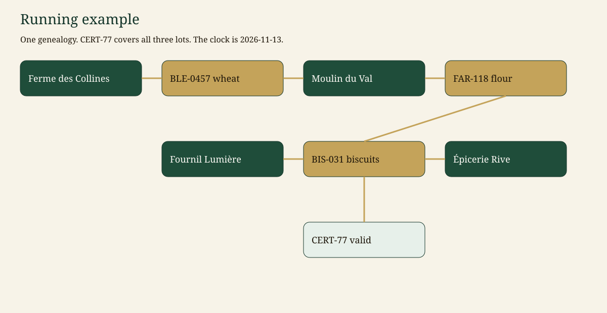

| Step | Id | What happens |
| --- | --- | --- |
| Commission | `BLE-0457` | Ferme des Collines harvests 12 000 kg of wheat on 2026-06-12 |
| Transformation | `P-MILL-118` | Moulin du Val mills that wheat into flour `FAR-118` (9 400 kg) on 2026-07-03 |
| Transformation | `P-BAKE-031` | Fournil Lumière bakes the flour into biscuits `BIS-031` (7 100 kg) on 2026-07-22 |
| Shipments | `SHIP-BIS-1`, `SHIP-BIS-2` | Bakery → DistriNord → Épicerie Rive |
| Certificate | `CERT-77` | Organic Horizon, **valid** 2025-04-01 to 2027-12-31, covers all three lots |

The demo clock is **2026-11-13** (`AGRITRACE_AS_OF`). It does not follow the wall clock, so `CERT-77` stays valid and `CERT-78` stays expired in CI.

Same identifiers in the seed ([`src/agritrace/data/generator.py`](src/agritrace/data/generator.py)), the eval set ([`src/agritrace/eval/dataset.json`](src/agritrace/eval/dataset.json)), the tests, and the answers below.

<details>
<summary>The other lots, and why they are not the example</summary>

| Id | Why it exists |
| --- | --- |
| `BLE-0881` | Wheat from Ferme Brume. Covered only by expired `CERT-78` (valid_to 2026-03-01). |
| `BLE-0902` | Wheat from Ferme des Saules with valid `CERT-79`. |
| `FAR-221` | Flour mixed from `BLE-0881` and `BLE-0902`. Organic claim, no valid certificate, mixed inputs. |
| `OIL-009` | Olive oil whose transformation declares olives and **no source lot** (`broken_chain`). |

`BLE-0457` is not an input of `FAR-221`. Recalling the wheat does not recall the mixed flour, and the mixed flour does not appear in the biscuit trace.

</details>

---

## 4. Architecture

### 4.1 What this repository runs

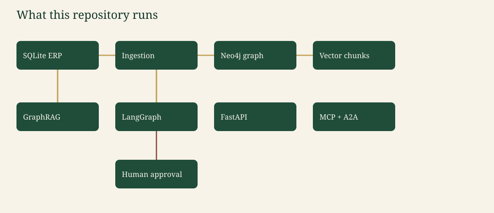

```mermaid
%%{init: {'theme': 'base', 'themeVariables': {'primaryColor': '#1F4D3A', 'primaryTextColor': '#F7F3E8', 'primaryBorderColor': '#14352A', 'lineColor': '#C4A35A', 'secondaryColor': '#F4E8C1', 'tertiaryColor': '#E7F0EA', 'fontFamily': 'Georgia, serif'}}}%%
flowchart LR
  erp["SQLite ERP"]
  ingest["Ingestion and quality checks"]
  graph["Neo4j property graph"]
  vec["Chunk vectors"]
  rag["GraphRAG"]
  agents["LangGraph supervisor"]
  api["FastAPI"]
  mcp["MCP tools"]
  a2a["A2A card and tasks"]
  human["Human approval"]

  erp --> ingest --> graph
  ingest --> vec
  graph --> rag
  vec --> rag
  rag --> agents
  agents --> api
  agents --> mcp
  agents --> a2a
  agents --> human
  human --> agents

  classDef box fill:#1F4D3A,stroke:#14352A,color:#F7F3E8;
  class erp,ingest,graph,vec,rag,agents,api,mcp,a2a,human box;
```

| Piece | Role in this repo |
| --- | --- |
| SQLite ERP | System of record for actors, lots, events, certificates, and document text. [`src/agritrace/data/schema.sql`](src/agritrace/data/schema.sql) |
| Ingestion | Quality-check, write SQL, read SQL, project into the graph. [`src/agritrace/service.py`](src/agritrace/service.py) |
| Neo4j | Constraints, `INPUT_OF` lineage, vector index. Used when `GRAPH_BACKEND=neo4j`. |
| Memory graph | Same answers without Docker. This is what CI runs. |
| GraphRAG | Walk + chunk search. |
| LangGraph | Route, tools, checkpointer, interrupt. |
| FastAPI | `/ask`, `/lots/...`, `/cypher`, MCP is a separate stdio process, A2A is HTTP. |
| Human | Required before the text “Recall issued” is produced. |

### 4.2 Context, containers, deployment

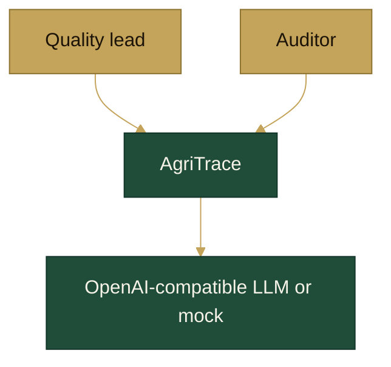

`compose.yaml` runs Neo4j 5.26 and the API. Browser ports are bound to `127.0.0.1`. The API listens on `0.0.0.0:$PORT` inside the container. CI does not start Docker: it sets `GRAPH_BACKEND=memory` and `LLM_MODE=mock`.

### 4.3 Sequence: trace, then a recall that waits

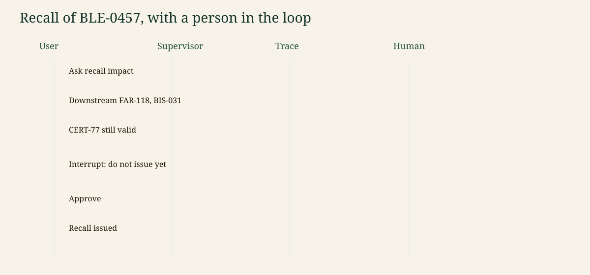

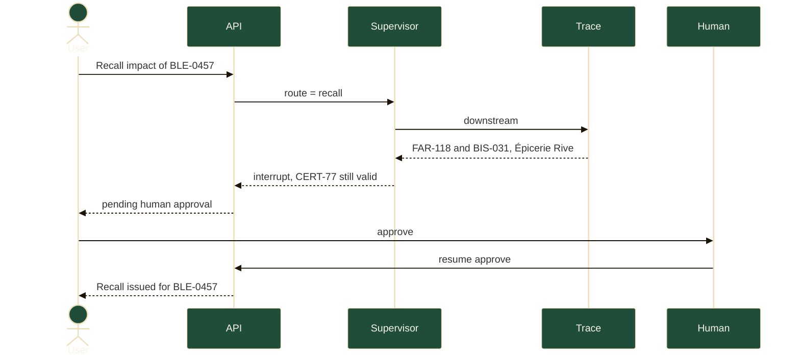

Until resume, the answer says **pending** and does **not** say the recall was issued.

### 4.4 Target architecture for a certification company

This is a **target**, not the deployment of this repository. The repo is the reference slice (one SQL file, one graph, one process, a mock model).

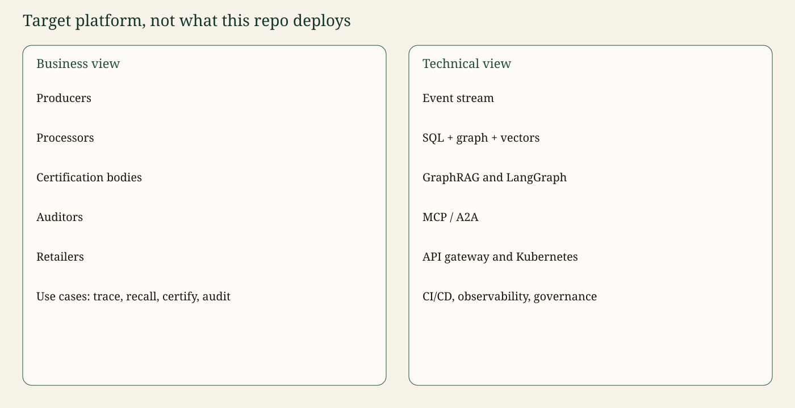

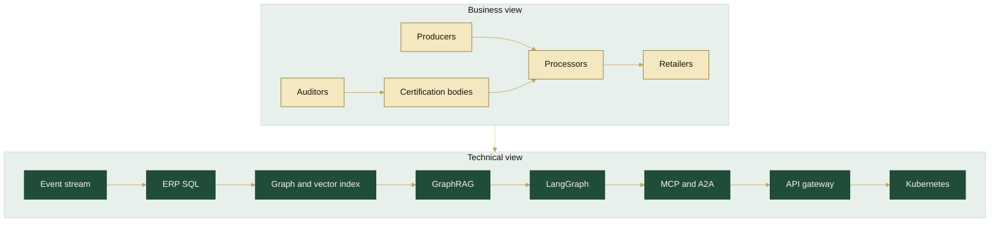

| Business use case | Technical path |
| --- | --- |
| Trace a lot | Stream or ERP event → `INPUT_OF` walk |
| Recall | Downstream closure, proposal, human task, then a message to retailers |
| Certify | Certificate node with `valid_from` / `valid_to`, linked to lots |
| Audit | Unstructured report chunked, embedded, linked to the site and lots |

Cross-cutting on the target platform: an API gateway with real identity, row-level security enforced in the graph query, an append-only audit log, OpenTelemetry to a collector, policy checks on the LLM gateway, and CI/CD that promotes ontology versions. Section 9 is the control list. Section 16 says which of those controls are only sketched here.

---

## 5. Ontology and graph schema

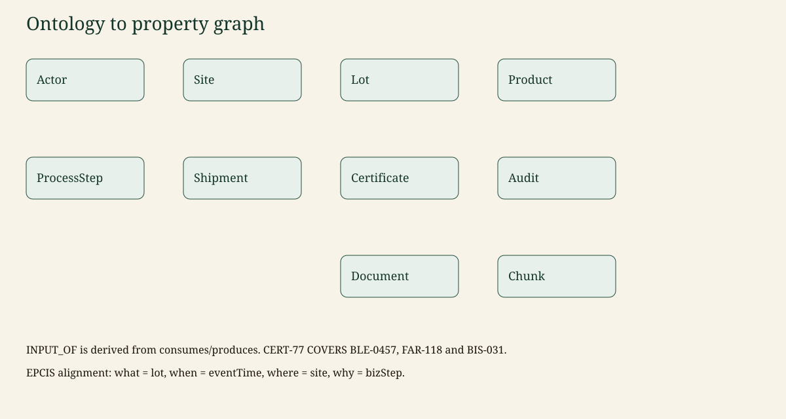

Classes in [`ontology/traceability.ttl`](ontology/traceability.ttl): Actor, Site, Product, Ingredient, Lot, ProcessStep (commissioning or transformation), Shipment, Certificate, Audit, Document, Chunk.

| Relation | From → to | EPCIS hint |
| --- | --- | --- |
| `OPERATES` | Actor → Site | owning party of a location |
| `PRODUCED_AT` | Lot → Site | bizLocation |
| `OF_PRODUCT` | Lot → Product | trade-item class |
| `CONSUMES` / `PRODUCES` | ProcessStep → Lot | input and output quantities |
| `INPUT_OF` | Lot → Lot | derived lineage, not a second event |
| `CONTAINS`, `SHIPPED_FROM`, `SHIPPED_TO` | Shipment | shipping |
| `COVERS` | Certificate → Lot, Site, or Actor | not core EPCIS |
| `ISSUED_BY` / `HELD_BY` | Certificate → Actor | |
| `AUDITS` / `EVIDENCES` | Audit → Site / Certificate | |
| `PART_OF` / `MENTIONS` | Chunk → Document / entity | retrieval |

Rules encoded in the compliance function, not only in prose:

- A **commissioning** step may have no input lots (a harvest).
- A **transformation** with no input lots is `broken_chain` (`OIL-009`).
- A transformation whose inputs do not share the same certificate state is `mixed_lots` (`FAR-221`).
- A claimed scheme needs a covering certificate with `valid_from ≤ as_of ≤ valid_to`. Expired `CERT-78` does not count.
- `CERT-77` covers `BLE-0457`, `FAR-118`, and `BIS-031`, so the biscuit lot is compliant on 2026-11-13.

Neo4j constraints (one unique `id` per label) live in [`src/agritrace/graph/schema.py`](src/agritrace/graph/schema.py):

```cypher
CREATE CONSTRAINT lot_id IF NOT EXISTS FOR (n:Lot) REQUIRE n.id IS UNIQUE
```

Example read query for the running chain:

```cypher
MATCH (wheat:Lot {id: 'BLE-0457'})-[:INPUT_OF]->(flour:Lot {id: 'FAR-118'})
      -[:INPUT_OF]->(biscuits:Lot {id: 'BIS-031'})
MATCH (cert:Certificate {id: 'CERT-77'})-[:COVERS]->(biscuits)
RETURN wheat.id AS wheat, flour.id AS flour, biscuits.id AS biscuits, cert.id AS certificate
LIMIT 5
```

The Cypher guard accepts this query. The memory backend returns the hero row. Neo4j executes the same text after ingestion.

---

## 6. Agents

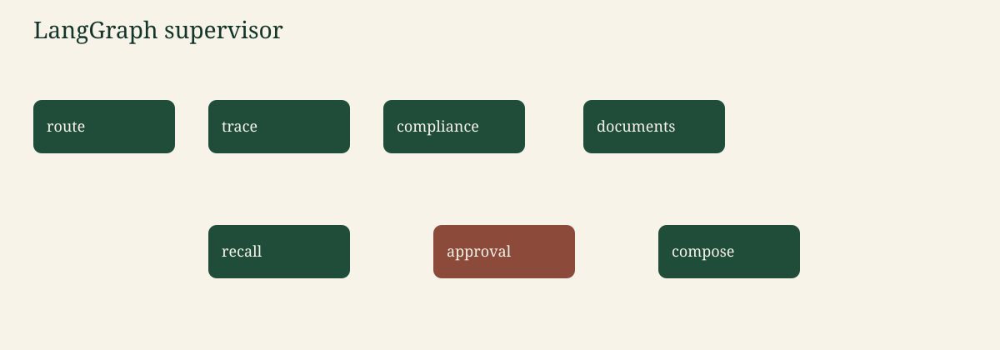

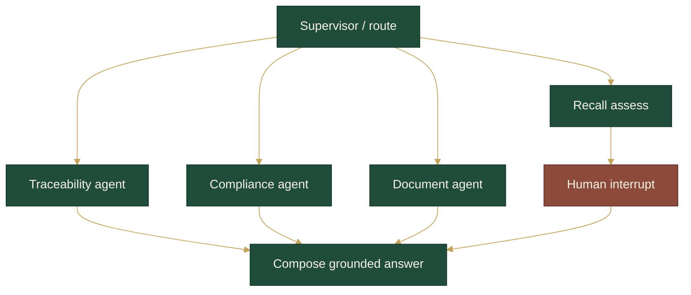

| Node | Job |
| --- | --- |
| Supervisor | Keywords in English or French pick `trace`, `compliance`, `documents`, or `recall`, and pick upstream vs downstream. A lot id in the question (`BLE-0457`, `FAR-118`, `BIS-031`, `OIL-009`) is extracted, not guessed. |
| Traceability | Walk `INPUT_OF` upstream and/or downstream. Cite lots, sites, actors, shipments, certificates. |
| Compliance | Walk upstream of a lot and apply the certificate rules. With no lot, list expired certificates. With only `CERT-77`, return its scope. |
| Documents | Hybrid search over certificate and audit text, then one graph hop from a mentioned lot. |
| Recall | Downstream closure plus the certificate note. Writes the proposal. Does not issue it. |
| Approval | `interrupt(...)`. The checkpointer holds the thread. Resume with `approve` or `reject`. Only the **regulator** role can approve. |
| Compose | Turns tool payloads into the answer and citations. The mock narrative cannot add new ids. |

Typed state is `GraphState` in [`src/agritrace/agents/graph.py`](src/agritrace/agents/graph.py): question, route, lot id, direction, principal, trace, compliance, documents, citations, recall proposal, human decision, answer, status, injection flags.

The checkpointer is LangGraph’s in-memory saver (`MemorySaver`). It is process-local. A restart forgets threads. That is acceptable for the demo and called out on the roadmap.

The interrupt is inside the approval node, **after** the proposal is stored and **before** compose writes “Recall issued”.

---

## 7. Retrieval

Hybrid retrieval is two tools, then a grounded paragraph.

1. **Graph.** `trace` / `check_lot` in [`src/agritrace/graph/lineage.py`](src/agritrace/graph/lineage.py). Exact. Used for `BIS-031` upstream and for `CERT-77`.
2. **Vectors.** Document paragraphs become `Chunk` nodes with a 64-d hashing embedding in mock mode (or an OpenAI-compatible `/embeddings` call when `LLM_MODE=openai`). Search mixes cosine similarity with token overlap so the mill audit ranks first for “mixed” without a network call. Neo4j stores the same vector in index `chunk_embedding`.
3. **Text-to-Cypher.** A LangChain prompt carries the schema card. Mock mode emits one of a few `MATCH` templates. Every string passes [`validate_cypher`](src/agritrace/security/cypher_guard.py) before execution: one statement, starts with `MATCH`, has `RETURN`, no `CREATE` / `DELETE` / `SET` / `CALL`, labels and relationship types from the allow-list, `LIMIT` at most 50.

Guardrail limits, stated plainly:

- The guard does not prove the query is the best query. It proves it cannot write.
- The memory engine executes the known templates, including the hero `INPUT_OF` query. Arbitrary read shapes run on Neo4j.
- User text is data. Patterns such as “ignore previous instructions” are logged and the narrative model is not given the question. The trace still runs on the extracted lot id.
- Citations are ids that came back from tools. A narrative that introduces a new id is dropped.

---

## 8. Tools

| Tool | What it is | Why it is here | Where |
| --- | --- | --- | --- |
| Neo4j, Cypher, vector index | Property graph and cosine index | Lineage queries and chunk search | `graph/schema.py`, `graph/neo4j_store.py` |
| OWL, Turtle, rdflib | Vocabulary file and parser | Versioned catalog of classes | `ontology/traceability.ttl` |
| GS1 EPCIS (ideas only) | Event questions what/when/where/why | Keeps the model familiar to supply-chain readers | ontology comments |
| SQLite (Postgres-shaped SQL) | ERP extract | Shows where relational data still belongs | `data/schema.sql`, `data/erp.py` |
| Python 3.11, Pydantic | Language and records | Typed lots, certificates, API bodies | `models.py` |
| LangChain | Prompt templates | Schema-grounded Cypher prompt, narrative prompt | `llm/provider.py` |
| LangGraph | Stateful workflow | Supervisor, interrupt, checkpointer | `agents/graph.py` |
| MCP SDK | Tool protocol | `trace_lot`, `check_certificates`, `search_documents` | `mcp/server.py` |
| A2A (minimal) | Agent card + task POST | A labelled example, not a full stack | `a2a/card.py` |
| FastAPI | HTTP API | Ask, resume, trace, Cypher, health | `api/main.py` |
| Streamlit | Small UI | Ask as a chosen actor, approve a recall | `ui/streamlit_app.py` |
| OpenTelemetry | Traces | Spans on ingest, trace, search, ask | `observability/otel.py` |
| LangSmith | Optional hosted traces | Off unless `LANGCHAIN_TRACING_V2=true` | env only |
| OpenAI-compatible LLM / mock | Chat and embeddings | Mock is the default and the CI path | `llm/provider.py` |
| Docker Compose | Neo4j + API | One command local stack | `compose.yaml` |
| pytest | Tests | Hero chain, RBAC, interrupt, HTTP | `tests/` |
| GitHub Actions | CI | Ruff, mypy, pytest, eval, mock mode | `.github/workflows/ci.yml` |
| uv, ruff, mypy | Env, lint, types | `uv` optional; ruff and mypy run in CI | `pyproject.toml` |
| Mermaid | Diagrams in Markdown | Renders on GitHub | this README |

<details>
<summary>Neo4j, Cypher, and the vector index</summary>

**What.** A labelled property graph. Cypher is the query language. A vector index on `Chunk.embedding` answers similarity search.

**Why.** Variable-length lineage (`INPUT_OF*1..6`) and “which certificate covers this node” stay readable. A relational recall query across splits and merges becomes a pile of joins.

**Role.** `GRAPH_BACKEND=neo4j` merges the ERP extract, creates uniqueness constraints, and builds `chunk_embedding`. Trace math used by the agents is the shared Python engine so CI and Neo4j cannot drift. Neo4j still runs guarded Cypher and is the store you open in Browser.

**Alternative considered.** RDF store only (the ontology file would also be the instance store). Rejected for the traversal workload. PostgreSQL recursive CTEs could express one chain; they get awkward once shipments, certificates, and chunks join the question.

</details>

<details>
<summary>OWL, Turtle, rdflib, and EPCIS ideas</summary>

**What.** The vocabulary is OWL written in Turtle. rdflib loads it for `GET /ontology`.

**Why.** The catalog has a version (`owl:versionInfo "0.1.0"`) that is copied onto graph nodes at ingest (`ontology_version`). People can open the file in Protégé if they want a diagram editor. The demo does not need it.

**Role.** Classes and relations in section 5. EPCIS words (`bizStep`, `eventTime`, business location) are annotation properties, not an import of the GS1 ontology.

**Alternative.** A spreadsheet of column meanings. It would not carry relation domains or a version IRI.

</details>

<details>
<summary>SQLite and Postgres</summary>

**What.** The ERP is a SQL schema: actors, sites, products, lots, process inputs and outputs, shipments, certificates, audits, documents.

**Why.** Master data and stock events are born in transactional systems. The graph is a projection, not the ledger. Ingest always round-trips the dataset through SQLite before the graph load, including in tests.

**Role.** [`schema.sql`](src/agritrace/data/schema.sql) uses types that Postgres accepts (`TEXT`, `REAL`, JSON stored as text). The running engine is SQLite because CI should not need a second database. A Postgres DSN is not wired yet (roadmap).

**Alternative.** Generating Cypher only, with no SQL. That hides the system of record this project is meant to show.

</details>

<details>
<summary>Python, Pydantic, LangChain, LangGraph</summary>

**What.** Python 3.11. Pydantic models are the records that survive the SQL round trip. LangChain holds prompts. LangGraph holds the graph of nodes.

**Why.** Typed records stop a lot id from changing shape between SQL, graph, and JSON. Prompts stay in one place. The workflow needs a pause and a resume, which is what a graph plus checkpointer is for.

**Role.** `Lot`, `Certificate`, `AskResponse` in `models.py`. `CYPHER_PROMPT` and `NARRATIVE_PROMPT`. `build_agent` compiles the graph.

**Snippet.**

```python
CYPHER_PROMPT = ChatPromptTemplate.from_messages(
    [
        ("system", "Write one read-only Cypher query ...\n{schema}"),
        ("human", "{question}"),
    ]
)
```

**Alternative.** One Python script with no graph library. It would not show a checkpoint or an interrupt, which is the point of the recall flow.

</details>

<details>
<summary>MCP and the minimal A2A endpoint</summary>

**What.** Three MCP tools, registered on `MCPServer` (MCP Python SDK 2.x):

| Tool | Arguments | Returns |
| --- | --- | --- |
| `trace_lot` | `lot_id`, `direction` (`upstream`, `downstream`, `both`), optional `actor_id` | JSON lineage |
| `check_certificates` | `lot_id`, optional `actor_id` | JSON compliance report |
| `search_documents` | `query`, `k`, optional `actor_id` | JSON chunks the actor may see |

Empty `actor_id` uses the demo regulator when `AGRITRACE_DEMO_OPEN=1`. Passing `ACT-RIVE` applies that retailer’s row filter.

**A2A.** `GET /.well-known/agent-card.json` and `POST /a2a/tasks` with:

```json
{
  "id": "t-77",
  "message": {
    "role": "user",
    "parts": [{"type": "text", "text": "Trace BIS-031 upstream"}]
  }
}
```

The card’s `protocol` field is `a2a-minimal-0.1` so nobody confuses it with a full implementation.

**Alternative.** Only HTTP. MCP is here so a desktop assistant can call the tools without this repo’s UI. A2A is here so a second agent can find the card.

</details>

<details>
<summary>FastAPI, Streamlit, OpenTelemetry, LangSmith, the LLM gateway</summary>

**FastAPI** (`python -m agritrace.api.main`) serves health, ontology, quality findings, the audit log, `/ask`, `/ask/resume`, lot trace, lot compliance, document search, guarded `/cypher`, the agent card, and A2A tasks. Header `X-Actor-Id` selects the actor. You cannot become the regulator by sending a role header next to a farm id; the actor’s role comes from the graph.

**Streamlit** (`streamlit run ui/streamlit_app.py`) is the same service with buttons, including approve / reject when status is `needs_approval`.

**OpenTelemetry.** `start_span` wraps ingest, trace, search, and ask. `OTEL_EXPORTER=none` (default) installs a provider and does not export. `console` prints spans. `otlp` needs the optional extra `opentelemetry-exporter-otlp-proto-http` and `OTEL_EXPORTER_OTLP_ENDPOINT`.

**LangSmith.** Not imported. If you set `LANGCHAIN_TRACING_V2=true` and a key, LangChain’s own callbacks will emit traces. Leave it false in CI.

**LLM gateway.** `LLM_MODE=mock` or `openai`. OpenAI mode posts to `{LLM_BASE_URL}/chat/completions` with `LLM_MODEL` and `LLM_API_KEY`. Any compatible host works. Embeddings use `{LLM_BASE_URL}/embeddings` and must match `EMBEDDING_DIM` (64 for the mock hash, often 1536 for a hosted model — recreate the Neo4j index if you change it).

**Alternative.** A single vendor SDK. Rejected so the demo runs with no key and so the gateway can point at another host.

</details>

<details>
<summary>Docker Compose, pytest, GitHub Actions, uv, ruff, mypy, Mermaid</summary>

**Compose** pins `neo4j:5.26.0-community` and builds the API image. The Neo4j password uses `${NEO4J_PASSWORD:-devpasswordlocal}` and that fallback is a local convenience only.

**pytest** covers the hero chain, SQL round trip, Cypher rejection, the eval set, the recall interrupt, retailer denial, prompt injection, MCP tool names, and HTTP.

**CI** on push and pull request: Python 3.11, `pip install -e ".[dev]"`, ruff, mypy, pytest, `python -m agritrace.eval.runner`, all with `LLM_MODE=mock`.

**uv** can create the 3.11 environment (`uv venv --python 3.11`). CI uses pip so the workflow stays ordinary. **ruff** lints and formats. **mypy** type-checks `src` with `disallow_untyped_defs`.

**Mermaid** is the diagram source in this README (GitHub renders it). SVG and PNG copies for Confluence are in [`docs/assets/`](docs/assets/). Regenerate with `python scripts/render_assets.py`.

</details>

---

## 9. Security and governance

| Control | What the demo actually does |
| --- | --- |
| Lineage | Every graph node is tagged `source_system=erp-sqlite` and `ontology_version=0.1.0` |
| Catalog | `GET /ontology` lists classes from the Turtle file |
| Ontology version | `owl:versionInfo` in the TTL file. Changing it is a deliberate edit, not a side effect |
| Data quality | Referential checks in `data/quality.py`. Dangling ids fail the load. Expired certificates and broken chains are **findings**, because they are the scenario |
| Row-level access | `security/rbac.py`. A retailer sees lots shipped **to** them and the upstream of those lots, not another retailer’s goods. Producers see downstream of what they made (recall duty) but not a neighbour’s co-input. Certifiers see lots their certificates cover, plus downstream. Auditors see lots at sites they audited. The regulator sees everything |
| Tool rights | `read_cypher` is auditor and regulator only. `approve_recall` is regulator only |
| Secrets | `.env` is gitignored. `.env.example` has empty keys. The Compose password fallback is labelled as local-only |
| PII / GDPR | The dataset has no real people. Auditor and company names are fictional. Questions are stored in the process audit log for the demo; a production log should keep a hash or a redacted question, and a retention period. No personal data is sent to a model in mock mode |
| Prompt injection | Patterns (ignore instructions, role override, delete the graph, “do not cite”) are flagged. The narrative model does not see the raw question. Tools still use the extracted lot id |
| Read-only Cypher | `validate_cypher` rejects writes, comments, stacked statements, unknown labels, unknown relationships, and `LIMIT` above 50 |
| Grounded output | Answers are rendered from tool payloads. Citations are those ids. A narrative that adds an id is replaced with a suppression note |
| Audit log | `security/audit_log.py` appends each ask, denial, and resume. `GET /audit`. Optional JSONL via `AUDIT_LOG_PATH`. Process memory is not a vault |
| Human in the loop | Recall status stays `needs_approval` until `/ask/resume` with `approve` or `reject` |
| LLM gateway policy | Mock by default. OpenAI mode is explicit, temperature 0, and still behind the Cypher guard and the grounding check |
| EU AI Act notes | This is a portfolio demo, not a deployed decision system. A recall recommendation that can pull product off shelves is the kind of action that needs a human, which is why the interrupt exists. Transparency: the answer says when the narrative was suppressed and cites graph ids. These sentences are engineering notes, not legal advice |
| Monitoring | OpenTelemetry spans. Health endpoint returns mode, clock, and counts |

Demo open access (`AGRITRACE_DEMO_OPEN=1`) maps a missing actor to the regulator so the quickstart works. Set it to `0` and the API returns 401 until `X-Actor-Id` is set. Do not treat the default as an authentication design.

---

## 10. Design choices and limits

<details>
<summary>Graph beside relational, not instead of it</summary>

SQL keeps the ledger (quantities, foreign keys, the document body). The graph keeps the questions that walk a chain. Ingestion is the contract between them. Limit: the Postgres driver is not plugged in; the schema is the portable part.

</details>

<details>
<summary>Hybrid GraphRAG rather than text-to-Cypher alone</summary>

A generated query is a good ad-hoc tool and a bad single source of truth. The trace and compliance agents call deterministic functions. Text-to-Cypher is attached for regulator and auditor questions and is rejected when it is not a read. Limit: the in-memory executor understands the templates the mock writer emits, not every legal `MATCH`.

</details>

<details>
<summary>Shared Python lineage, Neo4j as the queryable store</summary>

One implementation of upstream, downstream, and certificate rules feeds tests and the API. Neo4j receives the same facts so Browser and guarded Cypher work. Limit: a Cypher-only deployment would re-implement those rules in procedures. That is listed as in progress, not as done.

</details>

<details>
<summary>Mock LLM as the default</summary>

CI, the eval set, and the sample answers do not call a network and do not invent lot ids. Limit: the mock narrative is one fixed sentence. It shows the hook, not model quality. Switch `LLM_MODE=openai` when you want a hosted model to phrase an answer that still cannot add ids.

</details>

<details>
<summary>Decisions recorded as short ADRs</summary>

1. **Neo4j** for lineage traversals; OWL remains the vocabulary. RDF-only would make the recall walk harder to read.
2. **LangGraph** for a paused workflow. A single chain does not have a clean interrupt.
3. **MCP** for tools any client can call; a minimal A2A card so agent discovery is visible and clearly incomplete.
4. **Hybrid retrieval** so structural questions are not left to similarity.
5. **Mock mode** so the project runs and is graded without a key.
6. **SQL remains the system of record.** The graph is a projection.
7. **A person approves a recall.** The model proposes. Read-only Cypher is the matching write-protection on the database side.

Full text of each decision is also in [`docs/adr/`](docs/adr/).

</details>

---

## 11. Evaluation

[`src/agritrace/eval/dataset.json`](src/agritrace/eval/dataset.json) holds seven questions. The runner checks status, expected ids (in the answer or the citations), expected phrases, forbidden ids, and forbidden phrases. Exit code is 1 if any case fails. `pytest` calls the same runner.

| Case | Question | Expected |
| --- | --- | --- |
| upstream-biscuits | Trace `BIS-031` upstream | `BLE-0457`, `FAR-118`, Ferme des Collines, `CERT-77`. Not `FAR-221` |
| downstream-wheat | Downstream of `BLE-0457` | `FAR-118`, `BIS-031`, Épicerie Rive |
| cert-77-biscuits | Is `BIS-031` covered by `CERT-77`? | compliant, valid_to 2027-12-31 |
| recall-wheat | Recall impact of `BLE-0457` | `needs_approval`, not “Recall issued” |
| expired-catalog | Which certificates are expired? | `CERT-78` only |
| mill-audit | What did the mill audit say about mixed lots? | `major_nonconformity`, `FAR-221`, `CERT-78` |
| broken-oil | Is the `OIL-009` chain complete? | `broken_chain`, Pressoir des Olivettes |

On the mock stack this set scores **7/7**. That number measures the deterministic tools, not a hosted model.

---

## 12. Observability

Spans today:

| Span | When |
| --- | --- |
| `ingest.sql_to_graph` | ERP round trip and graph load |
| `graph.trace` | `trace_lot`, attribute `lot.id` |
| `graph.compliance` | certificate check |
| `retrieval.search` | document search |
| `agent.ask` | one user turn, attribute `enduser.role` |

No exporter is configured unless you opt in (section 8). The audit log is the business trace of decisions; OpenTelemetry is the technical trace of latency and failures. They are not the same store.

---

## 13. Continuous integration

Workflow: [`.github/workflows/ci.yml`](.github/workflows/ci.yml).

On every push and pull request the job:

1. checks out the repo,
2. installs Python 3.11 and `pip install -e ".[dev]"`,
3. runs `ruff check` and `ruff format --check` on `src`, `tests`, and `ui`,
4. runs `mypy src`,
5. runs `pytest`,
6. runs `python -m agritrace.eval.runner`.

Environment for steps 5 and 6: `LLM_MODE=mock`, `GRAPH_BACKEND=memory`, `AGRITRACE_AS_OF=2026-11-13`. No API key. No Neo4j service. Docker is not required for the badge to go green.

---

## 14. Quickstart

### Docker Compose (Neo4j + API)

The Neo4j password falls back to `devpasswordlocal` for this local stack only. Put a real value in `.env` if the port is reachable by anyone else.

```bash
cp .env.example .env
docker compose up --build -d
docker compose exec app python -m agritrace.ingest
docker compose exec app python -m agritrace.demo
```

API: `http://127.0.0.1:8000/health`. Neo4j Browser: `http://127.0.0.1:7474` (user `neo4j`).

`ingest` loads the ERP extract if you want that step on its own. The API also loads on startup. `demo` prints the questions in section 15.

### Same demo without Docker (what CI runs)

```bash
uv venv --python 3.11 && source .venv/bin/activate
uv pip install -e ".[dev]"
make demo
make test
```

`make api` serves FastAPI on port 8000. `make ui` serves Streamlit on port 8501. `make eval` prints the seven-case score.

MCP stdio server: `python -m agritrace.mcp.server`.

---

## 15. Example questions and answers

Captured from `python -m agritrace.demo` in mock mode. The narrative line is the mock model. The paragraphs above it are the grounded tool output.

### Trace the biscuits upstream

**Q.** Trace BIS-031 upstream

**Status.** `complete` / `trace`

```text
Upstream trace of BIS-031 (Biscuits sablés).
Lots: BLE-0457, FAR-118, BIS-031.
Path: BLE-0457 -> FAR-118 -> BIS-031.
Origin: BLE-0457 at Ferme des Collines (SITE-COLLINES), actor ACT-COLLINES.
Certificates: CERT-77.
Retail sites: Épicerie Rive (SITE-RIVE).
Shipments: SHIP-BIS-1, SHIP-BIS-2.
```

### Where the wheat went

**Q.** Which lots are downstream of wheat lot BLE-0457?

```text
Downstream trace of BLE-0457 (Blé tendre).
Lots: BLE-0457, FAR-118, BIS-031.
Path: BLE-0457 -> FAR-118 -> BIS-031.
Certificates: CERT-77.
Retail sites: Épicerie Rive (SITE-RIVE).
```

### Is CERT-77 still valid for the biscuits?

**Q.** Is biscuit lot BIS-031 covered by CERT-77, and is that certificate valid on 2026-11-13?

```text
BIS-031 is compliant for Organic Horizon as of 2026-11-13.
Covering certificates: CERT-77 (Organic Horizon, status valid, valid_to 2027-12-31).
Upstream lots walked: FAR-118, BLE-0457.
No expired certificate on this chain.
Production site: Fournil Lumière (SITE-LUMIERE).
```

### Recall, then a person

**Q.** What is the downstream recall impact of BLE-0457?

**Status.** `needs_approval`

```text
Recall recommendation pending human approval. No recall has been issued.
Root lot: BLE-0457.
Downstream lots: FAR-118, BIS-031.
Affected retail sites: Épicerie Rive (SITE-RIVE).
Certificate note: CERT-77 is still valid until 2027-12-31.
A human must approve before this recommendation is issued.
```

**Resume.** `approve` as the regulator.

```text
Recall issued for BLE-0457. Affected lots: FAR-118, BIS-031. Approved by regulator.
```

`CERT-77` being valid does not skip the interrupt. Asking for a recall is a recommendation, and a person still has to issue it. The mixed-flour line is not in this impact list.

### Other questions the demo prints

| Question | Result |
| --- | --- |
| Which certificates are expired? | `CERT-78`, Ferme Brume, valid_to 2026-03-01. `CERT-77` is not in that set. |
| What did the mill audit say about mixed lots? | Chunk `CHK-DOC-AUDIT-MILL-0`: `major_nonconformity`, `P-MIX-221` mixed `BLE-0881` (`CERT-78`) with `BLE-0902` into `FAR-221`. |
| Where was OIL-009 produced and is the chain complete? | `non-compliant`, `broken_chain`, Pressoir des Olivettes, no source lot. |

A retailer at Épicerie Rive (`ACT-RIVE`) can trace `BIS-031` and cannot trace `OIL-009`. The API returns 403.

---

## 16. Roadmap

**Done in this repository**

- Ontology 0.1.0 and the EPCIS-inspired mapping
- Fictional seed with `BLE-0457`, `FAR-118`, `BIS-031`, `CERT-77`, plus the anomaly lots
- SQLite ERP, quality checks, SQL → graph ingestion
- In-memory graph and Neo4j constraints, `INPUT_OF`, vector index
- Hybrid retrieval, schema-grounded text-to-Cypher, read-only guard
- LangGraph supervisor, three specialist paths, checkpointer, recall interrupt
- MCP tools and a labelled A2A card and task endpoint
- Mock LLM and an OpenAI-compatible gateway
- OpenTelemetry hooks and optional LangSmith env
- Eval set at 7/7 in mock mode, pytest, ruff, mypy, GitHub Actions
- Row-level access, decision audit log, injection flags, grounded citations

**In progress — not claimed as done**

- Postgres as a running ERP service (schema is portable; the driver is not connected)
- Full EPCIS 2.0 JSON-LD import
- Certificate rules implemented only as Neo4j procedures
- OIDC in front of `X-Actor-Id`, and row filters pushed into Cypher
- Append-only audit store with retention, instead of process memory
- A hosted LangSmith dashboard
- A complete A2A task lifecycle (this card is the minimal example)
- Ontology release process beyond editing `owl:versionInfo`

---

## 17. Résumé en français

<details>
<summary>Lire le résumé</summary>

AgriTrace est un projet de démonstration sur la traçabilité agroalimentaire. Les données sont **fictives**. Aucune entreprise cliente n’est citée.

La chaîne de référence est le blé `BLE-0457`, moulu en farine `FAR-118`, puis en biscuits `BIS-031`, couverts par le certificat `CERT-77` (schéma fictif « Organic Horizon », valide jusqu’au 2027-12-31). La question métier est double : remonter ou descendre le lot, et vérifier que le certificat est encore valable. Une recommandation de rappel s’arrête pour validation humaine avant d’être émise.

Le dépôt montre une ontologie OWL (Turtle), un extrait SQL, un graphe Neo4j, une recherche hybride (parcours + vecteurs), des agents LangGraph, trois outils MCP, et une carte A2A minimale. Les tests et l’intégration continue tournent sans clé d’API (`LLM_MODE=mock`).

Le texte complet en français est dans [`docs/fr/README_fr.md`](docs/fr/README_fr.md), [`docs/fr/concepts.md`](docs/fr/concepts.md), [`docs/fr/architecture.md`](docs/fr/architecture.md), [`docs/fr/outils.md`](docs/fr/outils.md), [`docs/fr/securite-gouvernance.md`](docs/fr/securite-gouvernance.md) et [`docs/fr/architecture-cible.md`](docs/fr/architecture-cible.md).

</details>

---

Pages that repeat this README for other channels: [concepts](docs/concepts.md), [architecture](docs/architecture.md), [ontology](docs/ontology.md), [agents](docs/agents.md), [retrieval](docs/retrieval.md), [evaluation](docs/evaluation.md), [tools](docs/tools.md), [security and governance](docs/security-governance.md), [target architecture](docs/target-architecture.md), [ADRs](docs/adr/), [French](docs/fr/), [Confluence HTML](docs/confluence/).
