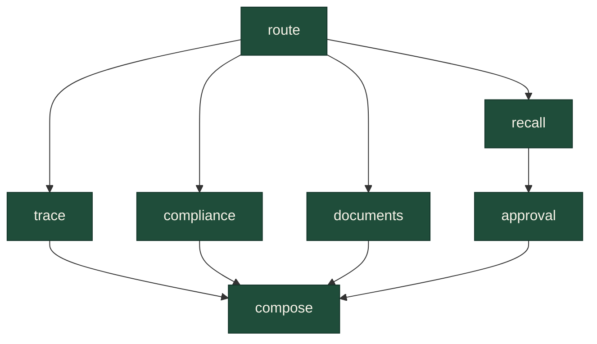
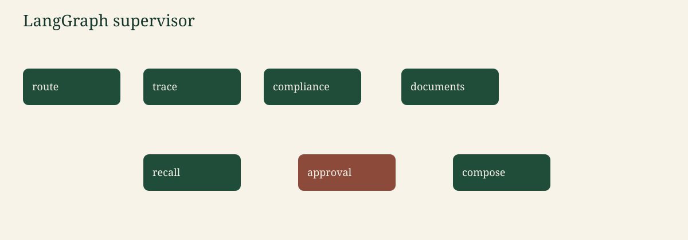

# Agents

Canonical copy: [README §7](../README.md#7-agents).

## State

`GraphState` carries the question, route, lot id, direction, principal, tool payloads, citations, recall proposal, human decision, answer, and injection flags. Values stored in the checkpointer are plain JSON-like structures.

## Nodes and edges

The supervisor routes with keywords (English and a few French words), not with a model call, so mock mode is stable.

- `trace` walks lineage.
- `compliance` checks certificates along the upstream chain, or lists expired certificates, or returns the scope of `CERT-77`.
- `documents` runs hybrid search.
- `recall` builds a proposal for the downstream lots. For `BLE-0457` that is `FAR-118` and `BIS-031`.
- `approval` calls `interrupt`. Resume with `approve` or `reject`.
- `compose` renders text from the payloads.

## Checkpointer and interrupt

`MemorySaver` keeps one thread id. The first call on a recall question returns `needs_approval` and does not say the recall was issued. `POST /ask/resume` with the same thread id continues the graph. Only `role=regulator` may approve; another role is recorded as a rejection.

The checkpointer is in-process. It is not a durable workflow engine.
