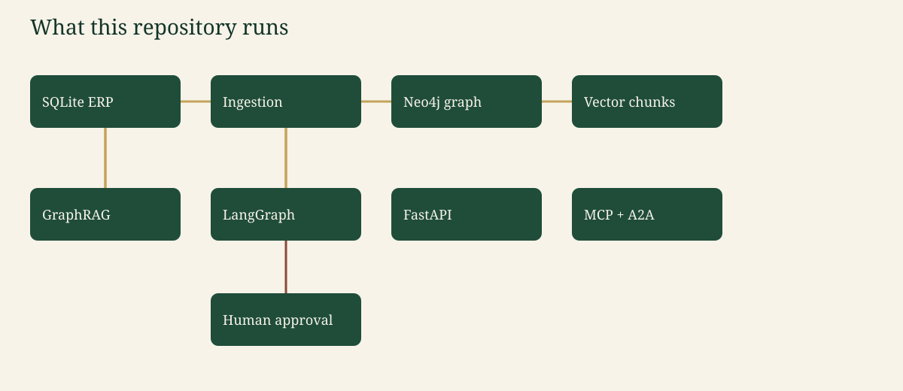
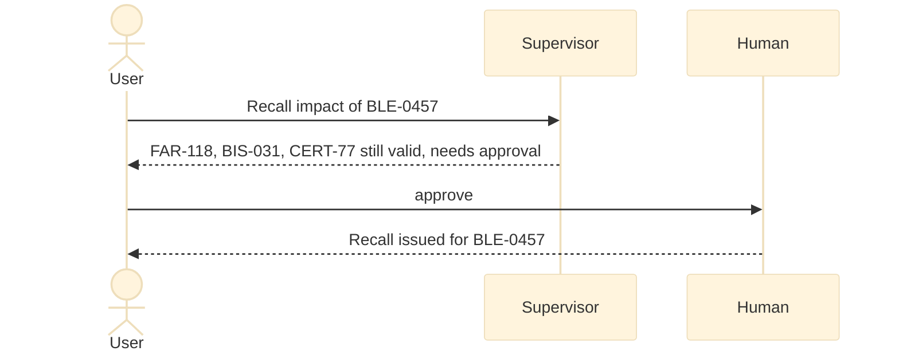
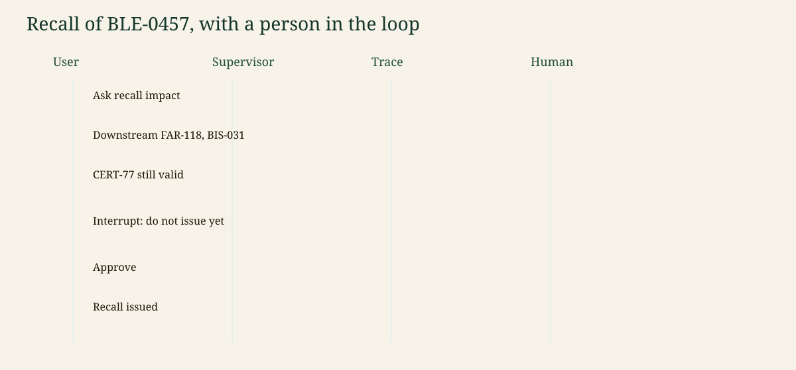

# Architecture

Canonical copy: [README §4](../README.md#4-architecture).

## Context

A quality lead or an auditor asks AgriTrace where a lot went and whether `CERT-77` still covers it. The language model is optional. Mock mode is the default.

## Containers in this repository

```mermaid
%%{init: {'theme': 'base', 'themeVariables': {'primaryColor': '#1F4D3A', 'primaryTextColor': '#F7F3E8', 'primaryBorderColor': '#14352A', 'lineColor': '#C4A35A', 'secondaryColor': '#F4E8C1', 'tertiaryColor': '#E7F0EA', 'fontFamily': 'Georgia, serif'}}}%%
flowchart LR
  erp["SQLite ERP"] --> ingest["Ingestion"] --> graph["Neo4j or memory graph"]
  ingest --> vec["Chunk vectors"]
  graph --> rag["GraphRAG"]
  vec --> rag --> agents["LangGraph"]
  agents --> api["FastAPI"]
  agents --> mcp["MCP"]
  agents --> a2a["A2A minimal"]
  agents --> human["Human approval"]
  classDef box fill:#1F4D3A,stroke:#14352A,color:#F7F3E8;
  class erp,ingest,graph,vec,rag,agents,api,mcp,a2a,human box;
```



SQL is the ledger. Ingestion checks referential integrity, writes SQLite, reads it back, and projects nodes. `GRAPH_BACKEND=memory` answers in-process (CI). `GRAPH_BACKEND=neo4j` also MERGEs into Neo4j 5.26 with uniqueness constraints and a vector index.

## Components

| Component | File |
| --- | --- |
| Dataset and anomalies | `src/agritrace/data/generator.py` |
| SQL | `src/agritrace/data/erp.py` |
| Lineage and certificates | `src/agritrace/graph/lineage.py` |
| Cypher guard, RBAC, audit log | `src/agritrace/security/` |
| Supervisor graph | `src/agritrace/agents/graph.py` |
| HTTP and A2A | `src/agritrace/api/main.py` |
| MCP | `src/agritrace/mcp/server.py` |

## Sequence for a recall of BLE-0457





## Deployment

`compose.yaml` starts Neo4j and the API. Ports publish on `127.0.0.1`. The container listens on `0.0.0.0:$PORT`. CI does not use Compose.

## Cross-cutting

Observability, the eval set, the LLM gateway, and security controls are sections 9–13 of the README. The richer company platform is [target-architecture.md](target-architecture.md).
