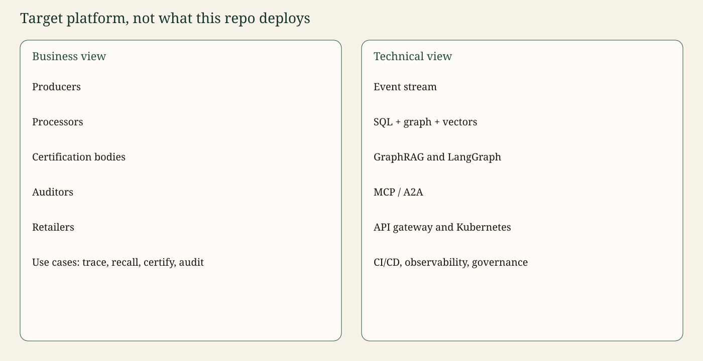

# Architecture cible

Ceci n’est **pas** le déploiement du dépôt. C’est la cible pour une organisation de certification agroalimentaire. Le dépôt en est la tranche de référence : `BLE-0457` → `FAR-118` → `BIS-031`, certificat `CERT-77`.

## Vue métier

Producteurs, transformateurs, organismes certificateurs, auditeurs, distributeurs et détaillants. Cas d’usage : tracer, rappeler, certifier, auditer.

## Vue technique

Flux d’événements, ERP SQL, graphe et index vectoriel, GraphRAG, LangChain pour les prompts, LangGraph pour les parcours avec validation humaine, MCP et A2A en bordure, passerelle d’API, Kubernetes, CI/CD. Transversal : identité, sécurité de ligne, journal d’audit durable, observabilité, politique du modèle.

Dans ce dépôt, le flux d’événements est un chargement SQL, l’identité est un en-tête d’acteur, et A2A est la carte minimale. Le README marque ces écarts comme « en cours », pas comme « fait ».
