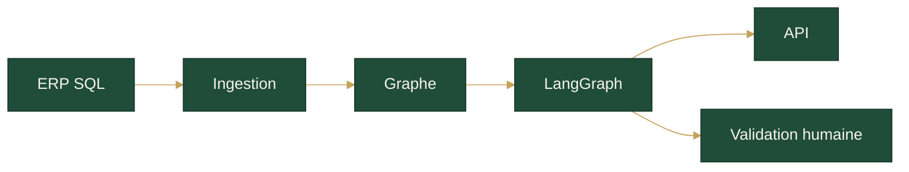
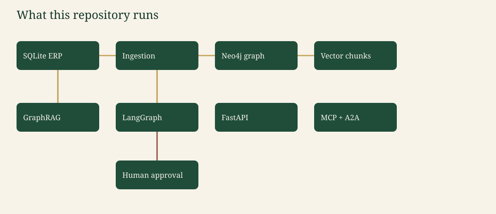

# Architecture

Le flux réel du dépôt : ERP SQLite → contrôles qualité → ingestion → graphe (mémoire en CI, Neo4j en Compose) et chunks → GraphRAG → superviseur LangGraph → API, MCP, carte A2A. Le rappel s’arrête pour une personne.

Pour `BLE-0457`, l’agent de traçabilité trouve `FAR-118` et `BIS-031`. La note indique que `CERT-77` est encore valide. Le statut reste `needs_approval` tant que personne n’a répondu `approve` ou `reject`.

L’architecture cible d’une société de certification (flux d’événements, Kubernetes, passerelle) est décrite à part : ce n’est pas le déploiement de `compose.yaml`. Voir [architecture-cible.md](architecture-cible.md).

