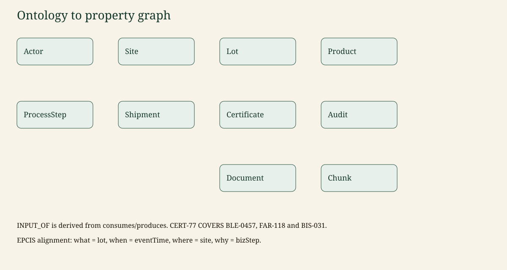

# Ontology

Canonical copy: [README §6](../README.md#6-ontology-and-graph-schema).

File: [`ontology/traceability.ttl`](../ontology/traceability.ttl), `owl:versionInfo "0.1.0"`.

## Classes

Actor, Site, Product, Ingredient, Lot, ProcessStep, Shipment, Certificate, Audit, Document, Chunk.

`ProcessStep` specialises into commissioning (a harvest may have no input lot) and transformation (an empty input list is a broken chain).

## Relations

`OPERATES`, `PRODUCED_AT`, `OF_PRODUCT`, `CONSUMES`, `PRODUCES`, `PERFORMED_AT`, `INPUT_OF`, `CONTAINS`, `SHIPPED_FROM`, `SHIPPED_TO`, `COVERS`, `ISSUED_BY`, `HELD_BY`, `AUDITS`, `EVIDENCES`, `ABOUT`, `PART_OF`, `MENTIONS`, `INGREDIENT_OF`, `USED_IN`.

`INPUT_OF` is derived from a process that consumes one lot and produces another. The process remains the event of record.

## EPCIS alignment

| AgriTrace | EPCIS idea |
| --- | --- |
| Lot | object id + lot / quantity |
| Site | business location |
| ProcessStep.event_time | eventTime |
| ProcessStep.biz_step | bizStep commissioning or transforming |
| Shipment | shipping event |
| Certificate, Audit | not core EPCIS; first-class here so validity is a query |

## Graph constraints

Each label has a unique `id` constraint. See `src/agritrace/graph/schema.py`. Chunks use vector index `chunk_embedding` (64 dimensions in mock mode).

## Example

```cypher
MATCH (wheat:Lot {id: 'BLE-0457'})-[:INPUT_OF]->(flour:Lot {id: 'FAR-118'})
      -[:INPUT_OF]->(biscuits:Lot {id: 'BIS-031'})
MATCH (cert:Certificate {id: 'CERT-77'})-[:COVERS]->(biscuits)
RETURN wheat.id, flour.id, biscuits.id, cert.id
LIMIT 5
```

`CERT-77` is valid from 2025-04-01 to 2027-12-31 and lists exactly those three lots.


