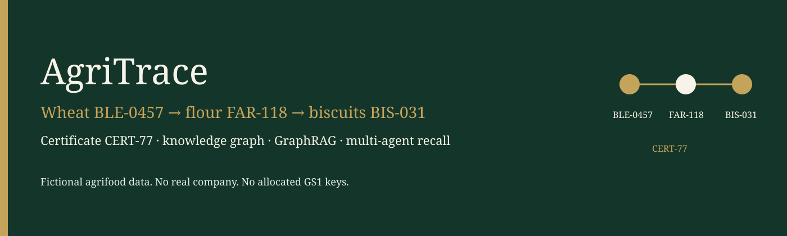

# Overview

AgriTrace is a fictional agrifood traceability demo for El Bachir Mourabit.

Business question: where did a lot come from, where did it go, and is its certificate still valid?

Running example, used in the seed, the tests, the eval set, and the README:

```text
wheat BLE-0457 → flour FAR-118 → biscuits BIS-031
certificate CERT-77, valid through 2027-12-31
```

The stack is a small OWL vocabulary, a SQL ERP extract, a property graph, hybrid GraphRAG, a LangGraph supervisor with a human interrupt before a recall, three MCP tools, and a minimal A2A card. Continuous integration runs with `LLM_MODE=mock` and no Neo4j.

All names and lots are fictional. No client company is described.

The long-form document is the [README](../README.md). Figures live in [assets](assets/).


