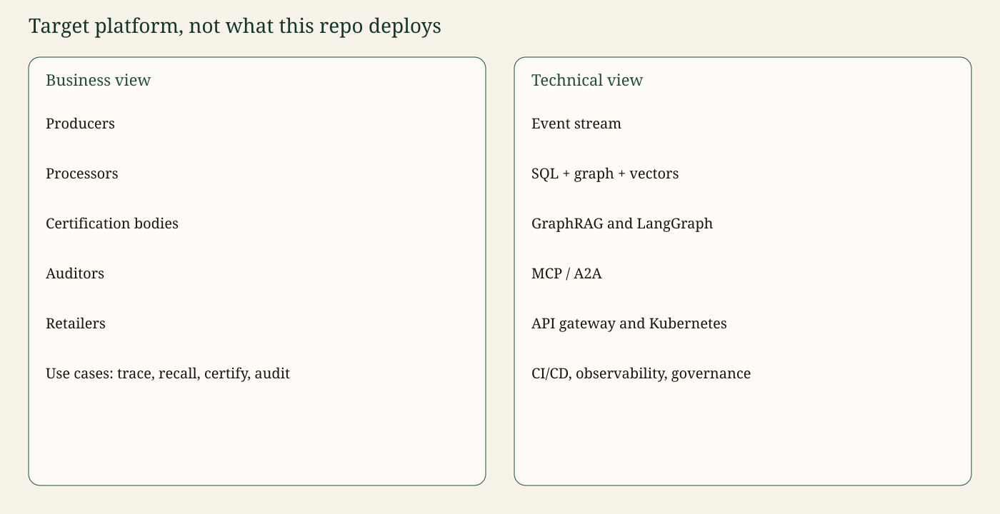

# Target architecture

Canonical copy: [README §4.4](../README.md#44-target-architecture-for-a-certification-company).

This page describes a platform for an agrifood certification organisation. **It is not what `compose.yaml` deploys.** The repository is the reference slice: one SQL extract, one graph, one API process, a mock model, and a human interrupt.



## Business view

| Actor | Needs |
| --- | --- |
| Producers | Prove the harvest lot and see where it went if there is a recall |
| Processors | Record transformations, including splits and mixes |
| Certification bodies | Issue and expire credentials such as `CERT-77` |
| Auditors | Attach findings to a site and to lots |
| Retailers | See the upstream of lots they received, not other shops’ lots |

Use cases: **trace**, **recall**, **certify**, **audit**.

## Technical view

```mermaid
%%{init: {'theme': 'base', 'themeVariables': {'primaryColor': '#1F4D3A', 'primaryTextColor': '#F7F3E8', 'primaryBorderColor': '#14352A', 'lineColor': '#C4A35A', 'secondaryColor': '#F4E8C1', 'tertiaryColor': '#E7F0EA', 'fontFamily': 'Georgia, serif'}}}%%
flowchart LR
  bus["Event stream"] --> erp["ERP SQL"] --> graph["Graph + vectors"]
  graph --> rag["GraphRAG"] --> lg["LangGraph"]
  lg --> edge["MCP / A2A"] --> gw["API gateway"] --> k8s["Kubernetes"]
  classDef t fill:#1F4D3A,stroke:#14352A,color:#F7F3E8;
  class bus,erp,graph,rag,lg,edge,gw,k8s t;
```

| Layer | Target | In this repo |
| --- | --- | --- |
| Ingestion | Stream of EPCIS-like events | Batch SQL extract |
| Stores | Postgres, Neo4j, vector index | SQLite, Neo4j optional, hash embeddings |
| Reasoning | LangChain prompts, LangGraph workflows | Implemented |
| Edges | MCP tools, A2A tasks | MCP plus a minimal card |
| Edge | API gateway, Kubernetes, CI/CD | FastAPI, Compose, GitHub Actions |
| Cross-cutting | Identity, row security, audit vault, OTel, LLM policy | Sketched and partly implemented (section 9 of the README) |

Identity, a durable audit log, and a full A2A lifecycle are on the roadmap, not done.
